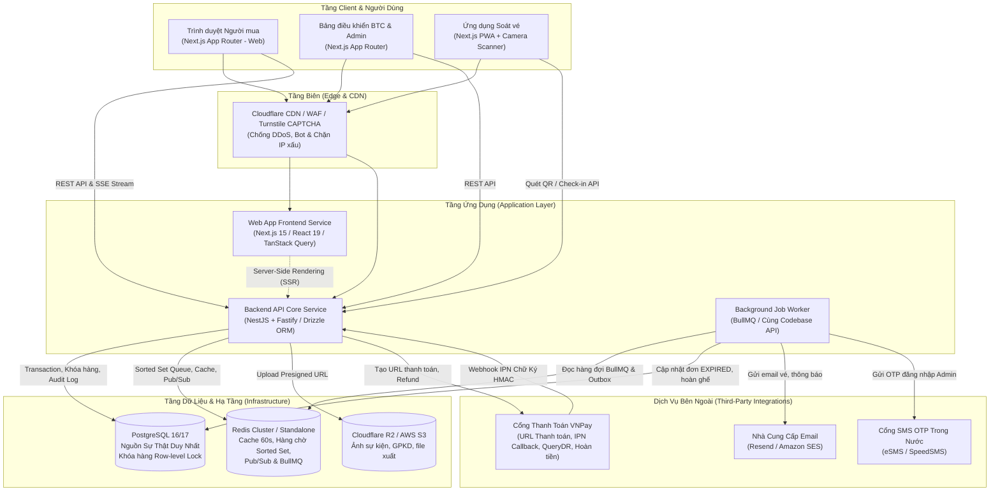
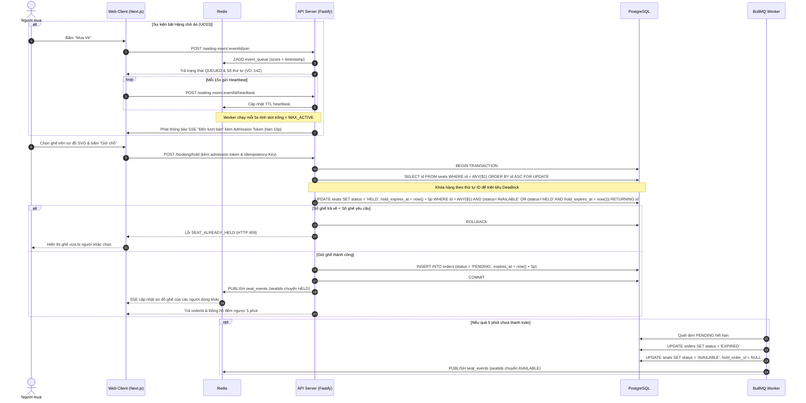
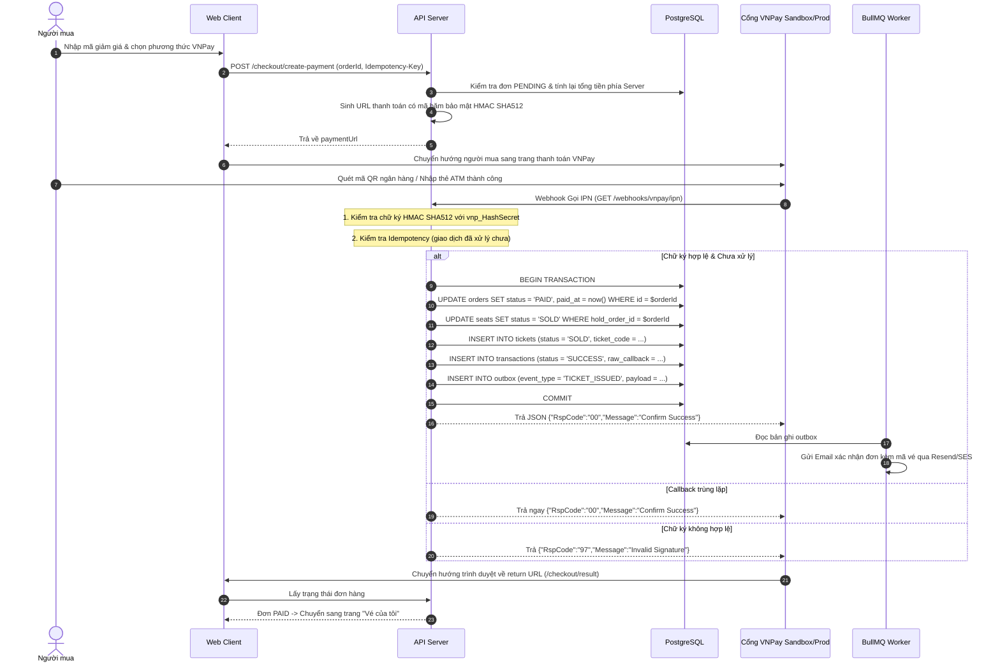
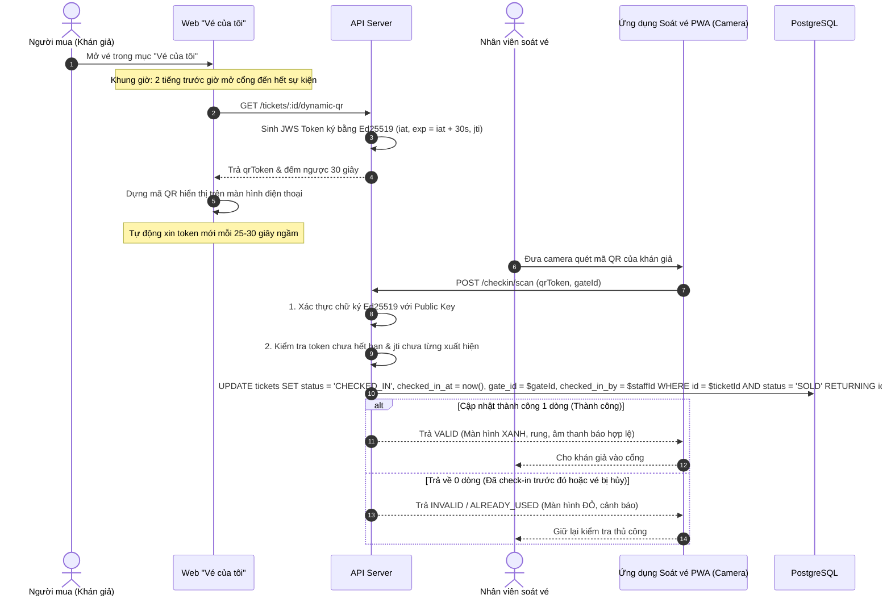

# Kiến Trúc Hệ Thống (System Architecture)
**Dự án:** Nền tảng bán vé sự kiện trực tuyến (TicketHub)  
**Tiêu chuẩn:** Microservices-Ready Modular Monorepo · High-Throughput Concurrency · Zero Double-Booking  

---

## 1. Kiến Trúc Tổng Thể (System Architecture Diagram)

Hệ thống được tổ chức theo mô hình **pnpm Monorepo** hiện đại, kết hợp sức mạnh render SEO của Next.js App Router phía Frontend và hiệu năng xử lý cao của NestJS trên nền tảng Fastify phía Backend.



---

## 2. Cấu Trúc Monorepo (Repository Layout)

```
ticket-hub/
├── apps/
│   ├── web/                          # Next.js App Router (Client, BTC, Admin, PWA)
│   │   ├── app/                      # App router layout & route groups
│   │   │   ├── (public)/             # Trang chủ, tìm kiếm sự kiện, chi tiết sự kiện
│   │   │   ├── (buyer)/              # Chọn ghế, checkout, Vé của tôi
│   │   │   ├── (organizer)/          # Dashboard BTC, tạo sự kiện, báo cáo
│   │   │   ├── (admin)/              # Dashboard Admin, duyệt sự kiện, đối soát
│   │   │   └── (gate)/               # Ứng dụng PWA quét vé tại cổng
│   │   ├── components/               # UI components (shadcn/ui, SeatMap SVG)
│   │   └── hooks/                    # Custom hooks (SSE, camera scanner, countdown)
│   │
│   └── api/                          # NestJS trên nền tảng Fastify
│       ├── src/
│       │   ├── modules/
│       │   │   ├── auth/             # JWT, argon2id, RBAC, Rate-limit
│       │   │   ├── events/           # Quản lý sự kiện, danh mục, upload ảnh
│       │   │   ├── seats/            # Sinh sơ đồ ghế, quản lý ghế
│       │   │   ├── booking/          # Khóa hàng SELECT FOR UPDATE, giữ chỗ 5p
│       │   │   ├── waiting-room/     # Hàng chờ ảo Redis Sorted Set, admission token
│       │   │   ├── payment/          # Adapter VNPay, IPN handler, querydr
│       │   │   ├── ticket/           # Ký số QR Ed25519, phát hành vé
│       │   │   ├── checkin/          # Soát vé nguyên tử, tra cứu thủ công
│       │   │   ├── refund/           # Chính sách hoàn vé, gọi refund VNPay
│       │   │   ├── reporting/        # Materialized views, xuất Excel/CSV
│       │   │   ├── admin/            # Phê duyệt, Kill Switch, đối soát chi trả
│       │   │   └── notification/     # Worker BullMQ, outbox email/SMS
│       │   └── main.ts               # Fastify bootstrap & global guards
│
├── packages/
│   └── shared/                       # Thư viện dùng chung cả Client và Server
│       ├── src/
│       │   ├── schemas/              # Zod schemas (Auth, Booking, Event, Payment)
│       │   ├── types/                # TypeScript types & DTOs
│       │   └── constants/            # Error codes, Enums, Timeouts
│
├── docker-compose.yml                # Chạy PostgreSQL 16 và Redis cho local dev
├── pnpm-workspace.yaml               # Cấu hình workspace
└── tsconfig.base.json                # TypeScript strict config dùng chung
```

---

## 3. Các Luồng Nghiệp Vụ Trọng Yếu (Critical Sequence Diagrams)

### 3.1 Luồng Giữ Chỗ Ghế & Hàng Chờ Ảo (UC03 & UC04)



---

### 3.2 Luồng Thanh Toán VNPay & IPN Xử Lý Idempotent (UC05)



---

### 3.3 Luồng Ký Số QR Động & Soát Vé Nguyên Tử Tại Cổng (UC05 & UC08)



---

## 4. Kiến Trúc Bảo Mật & Phòng Thủ (Security Architecture)

1. **Bảo Vệ Vé Giả Mạo & Chụp Màn Hình:**
   - Mã QR động sử dụng cơ chế token JWT ký bằng cặp khóa bất đối xứng **Ed25519 (EdDSA)**.
   - Khóa riêng (Private Key) chỉ lưu trữ trong Secret Manager trên server. Thiết bị soát vé chỉ sử dụng Khóa công khai (Public Key) để xác thực.
   - Token chỉ có hiệu lực tối đa 30 giây kèm mã dùng một lần (`jti`). Ảnh chụp màn hình gửi qua tin nhắn sẽ hết hạn trong vài giây.

2. **Cơ Chế Khẩn Cấp (Kill Switch - UC10):**
   - Khi Admin phát hiện sự kiện lừa đảo hoặc có sự cố an ninh nghiêm trọng, kích hoạt lệnh Kill Switch:
     - Trạng thái sự kiện chuyển thành `SUSPENDED`.
     - Lập tức chặn mọi API đặt chỗ, thanh toán và hủy các đơn đang giữ chỗ.
     - Toàn bộ hàng chờ ảo bị giải tán với thông báo chính thức.
     - Tự động chuyển các đơn đã thanh toán sang danh sách hoàn tiền hàng loạt.

3. **Chống Tấn Công Từ Chối Dịch Vụ & Bot:**
   - Cloudflare WAF và Turnstile CAPTCHA chặn bot tự động trước khi request chạm vào backend.
   - Rate limit theo IP và theo User ID trên các endpoint nhạy cảm (`/auth/login`, `/booking/hold`, `/checkout/create-payment`).

4. **Bảo Mật Dữ Liệu Cá Nhân (Nghị định 13/2023/NĐ-CP):**
   - Mọi mật khẩu băm bằng Argon2id với salt duy nhất.
   - Thông tin cá nhân nhạy cảm được mã hóa khi truyền (HTTPS/TLS 1.3) và khi lưu trữ (Encryption at Rest).
   - Quyền truy cập dữ liệu được phân chia chặt chẽ bằng Role-Based Access Control (RBAC).
