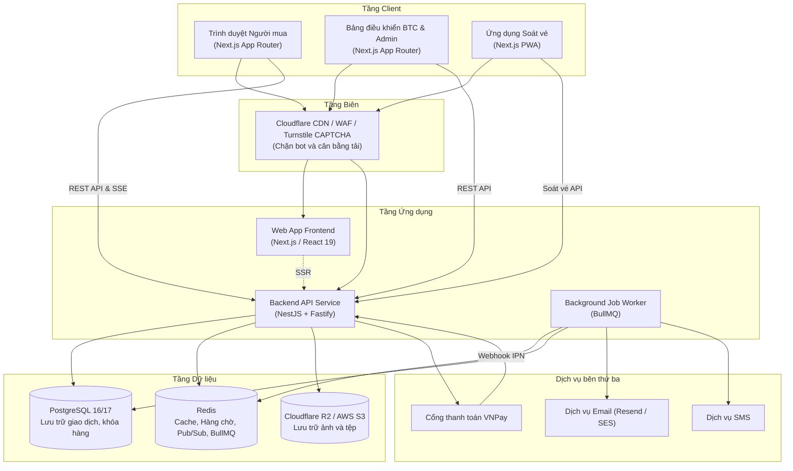
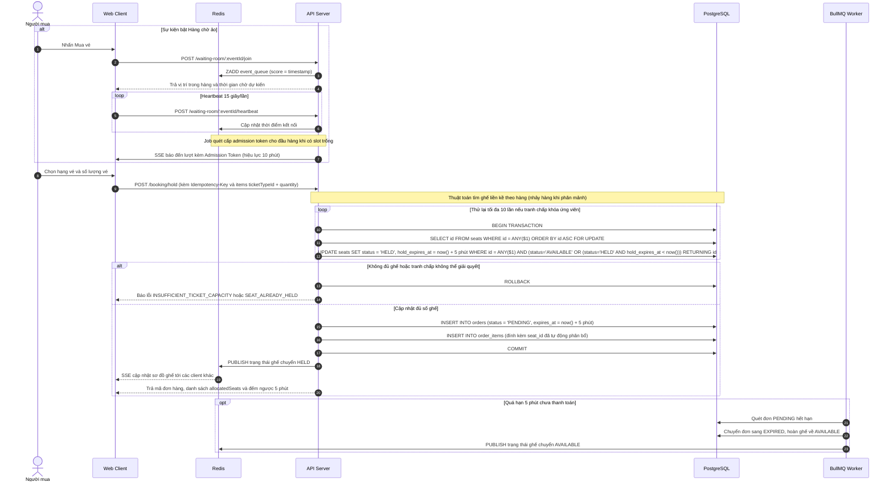
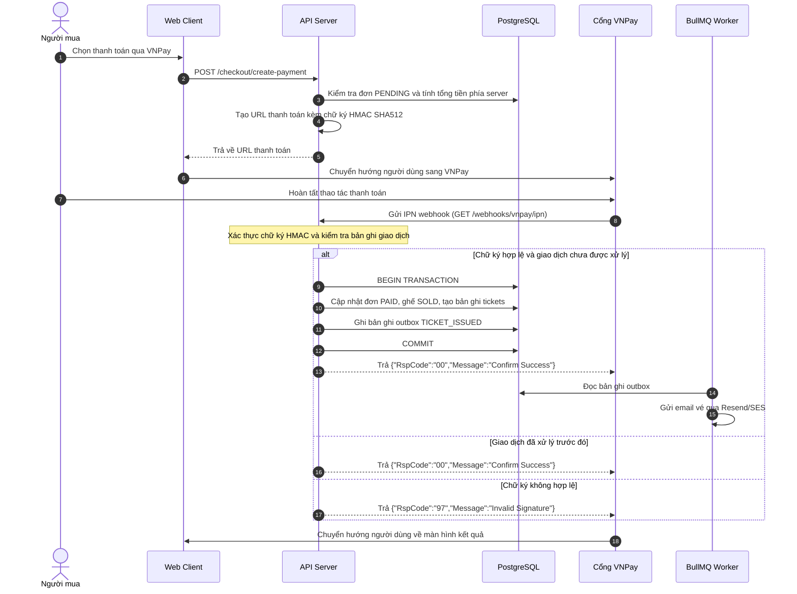
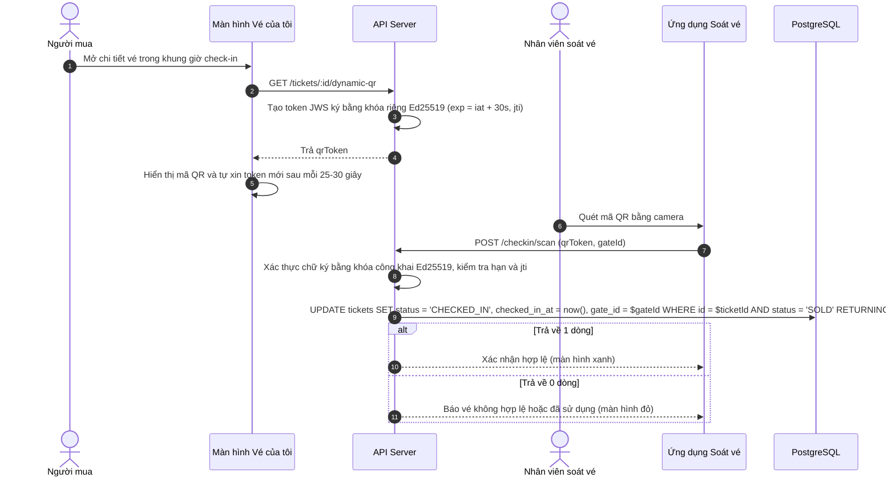
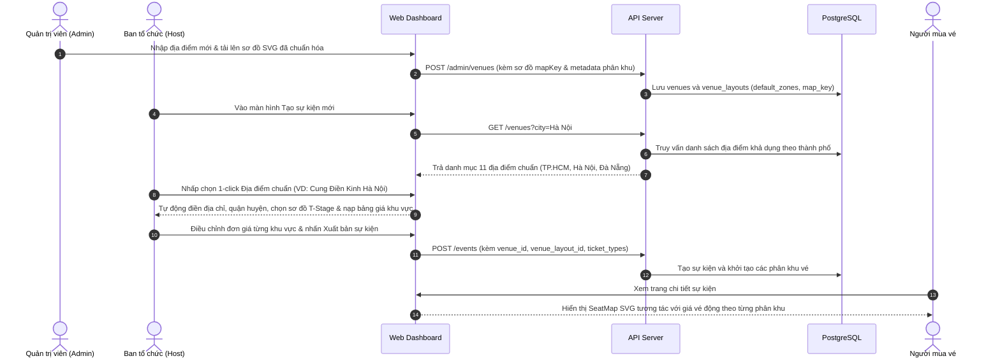

# Kiến trúc hệ thống

Tài liệu này mô tả kiến trúc tổng thể, mô hình phân chia module trong monorepo và các luồng xử lý đồng thời của hệ thống TicketHub.

## Kiến trúc tổng thể

Hệ thống được thiết kế theo mô hình monorepo, chia tách ứng dụng web và API backend, sử dụng PostgreSQL làm nơi lưu trữ trạng thái giao dịch và Redis làm lớp đệm trung gian.

## Cấu trúc thư mục

Kho mã nguồn sử dụng pnpm workspaces để quản lý các gói:

- `apps/web`: Ứng dụng giao diện người dùng xây dựng bằng Next.js App Router, bao gồm trang công khai, trang mua vé, bảng điều khiển ban tổ chức, bảng điều khiển quản trị viên và ứng dụng PWA soát vé.
- `apps/api`: Dịch vụ backend xây dựng bằng NestJS trên nền tảng Fastify. Các module nghiệp vụ được tách biệt (auth, events, seats, booking, waiting-room, payment, ticket, checkin, refund, reporting, admin, notification).
- `packages/shared`: Thư viện dùng chung chứa định nghĩa kiểu dữ liệu TypeScript, schema xác thực Zod và hằng số hệ thống.

## Ranh giới vai trò và Ma trận phân quyền

Hệ thống phân tách rõ trách nhiệm giữa các tầng client và vai trò người dùng nhằm ngăn ngừa xung đột lợi ích và bảo vệ tính minh bạch của thị trường vé:

| Vai trò        | Client tương tác     | Chức năng chính                                                                                                | Giới hạn nghiệp vụ (Restrictions)                                                   |
| :------------- | :------------------- | :------------------------------------------------------------------------------------------------------------- | :---------------------------------------------------------------------------------- |
| **BUYER**      | `BuyerBrowser`       | Mua vé, tham gia hàng chờ ảo, giữ chỗ ghế (`/booking/hold`), thanh toán qua VNPay, xem vé QR tại `/my-tickets` | Bị chặn truy cập các route `/admin/*` và `/organizer/*`                             |
| **ORGANIZER**  | `OrganizerDashboard` | Tạo sự kiện, cấu hình hạng vé, sơ đồ ghế, nộp hồ sơ KYC, xem báo cáo doanh thu                                 | **Không thể mua vé**, không có mục "Vé của tôi", bị chặn gọi API giữ chỗ và tạo đơn |
| **ADMIN**      | `OrganizerDashboard` | Phê duyệt sự kiện, duyệt hồ sơ ban tổ chức, đối soát tài chính, kiểm tra nhật ký kiểm toán                     | **Không thể mua vé**, không có mục "Vé của tôi", bị chặn gọi API giữ chỗ và tạo đơn |
| **GATE_STAFF** | `GateStaffPWA`       | Quét mã QR và xác thực vé vào cổng                                                                             | Không thể mua vé, không can thiệp cấu hình sự kiện                                  |

## Các luồng xử lý chính

### Giữ chỗ và điều tiết hàng chờ

Khi sự kiện mở bán lượng vé lớn, hàng chờ ảo được kích hoạt để giới hạn số lượng phiên giữ chỗ đồng thời không vượt quá ngưỡng `MAX_ACTIVE`. Nền tảng áp dụng cơ chế tự động phân bổ ghế liền kề (Auto Seat Allocation) theo hạng vé và số lượng, không yêu cầu người dùng chọn từng vị trí ghế thủ công nhằm tối ưu tốc độ mua vé và ngăn ngừa phân mảnh ghế ngồi.

### Thanh toán qua VNPay và xử lý webhook

### Ký số mã QR động và kiểm soát soát vé

Mã QR hiển thị trên ứng dụng là một token JWS có thời hạn ngắn (30 giây) để giảm nguy cơ chia sẻ ảnh chụp màn hình.

## Hệ thống Địa điểm Chuẩn & Quản lý Sơ đồ SVG (Curated Venues)

Hệ thống TicketHub chuẩn hóa quy trình tạo sự kiện thông qua mô hình Địa điểm Chuẩn (Curated Venues) và Sơ đồ SVG vector tương tác:

### 1. Phân quyền và kiểm duyệt sơ đồ (Admin Curation)

- Quản trị viên biên tập và duy trì danh mục các địa điểm tổ chức biểu diễn và thi đấu lớn tại 3 thành phố hạt nhân: **TP. Hồ Chí Minh** (SVĐ Thống Nhất, NTĐ Quân Khu 7, Nhà Hát Hòa Bình, NTĐ Hồ Xuân Hương), **Hà Nội** (SVĐ Quốc Gia Mỹ Đình, Cung Điền Kinh Hà Nội, SVĐ Hàng Đẫy, Nhà Hát Lớn Hà Nội), và **Đà Nẵng** (Cung Thể Thao Tiên Sơn, SVĐ Hòa Xuân, Nhà Hát Trưng Vương).
- Mỗi địa điểm được liên kết với một hoặc nhiều mẫu sơ đồ kiến trúc chuẩn dạng SVG (sân khấu chữ T concert, mega concert sân vận động ngoài trời, sân bóng đá tiêu chuẩn FIFA, sàn đấu bóng rổ VBA, khán phòng nhà hát thính phòng).
- Các tệp SVG được chuẩn hóa thuộc tính `data-zone` trên từng phần tử khán đài nhằm đồng bộ tự động với bảng mã phân khu vé của hệ thống.

### 2. Quy trình lựa chọn 1-click cho Ban tổ chức (Host)

- Ban tổ chức có thể lọc địa điểm trực quan theo thành phố (Tất cả, TP. Hồ Chí Minh, Hà Nội, Đà Nẵng), lọc theo danh mục không gian hoặc tìm kiếm nhanh theo từ khóa.
- Khi chọn địa điểm, hệ thống tự động điền toàn bộ thông tin địa danh, địa chỉ, đồng thời thiết lập sẵn mẫu sơ đồ kiến trúc tối ưu nhất kèm theo ma trận phân bổ vé và mức giá đề xuất thực tế.
- Ban tổ chức có thể xem trước trực quan sơ đồ SVG tương tác (xoay, thu phóng, rê chuột xem giá) trước khi hoàn tất phát hành vé.

### 3. Trải nghiệm chọn chỗ trực quan cho Người mua vé

- Sơ đồ SVG vector được hiển thị sắc nét trên mọi thiết bị và độ phân giải, hỗ trợ thao tác cảm ứng trên thiết bị di động và chuột trên máy tính bàn.
- Trạng thái từng phân khu (còn vé, sắp hết vé, hết vé) được cập nhật đồng bộ với hệ thống hàng chờ và giữ chỗ thông qua Server-Sent Events (SSE).

## Các biện pháp an toàn và giới hạn

### Giới hạn gian lận vé

- Cơ chế QR động giới hạn hiệu lực trong 30 giây giúp giảm thiểu việc chia sẻ ảnh chụp màn hình, nhưng không ngăn được việc người dùng đưa trực tiếp thiết bị của họ cho người khác vào cổng.
- Nhân viên soát vé vẫn duy trì quy trình kiểm tra đối chiếu giấy tờ tùy thân khi phát hiện dấu hiệu nghi vấn.

### Dừng khẩn cấp (Kill Switch)

- Khi phát hiện sự kiện vi phạm hoặc có khiếu nại nghiêm trọng, quản trị viên có thể chuyển trạng thái sự kiện sang `SUSPENDED`.
- Hệ thống sẽ chặn các yêu cầu đặt chỗ, thanh toán mới, hủy các đơn đang giữ chỗ và thông báo cho người dùng đang chờ trong hàng.

### Kiểm soát lưu lượng và bảo vệ ứng dụng

- Cloudflare áp dụng tường lửa ứng dụng (WAF) và Turnstile CAPTCHA để hạn chế lưu lượng truy cập từ bot tự động.
- API áp dụng rate limiting theo địa chỉ IP và tài khoản người dùng trên các endpoint nhạy cảm như đăng nhập, giữ chỗ và tạo thanh toán.
