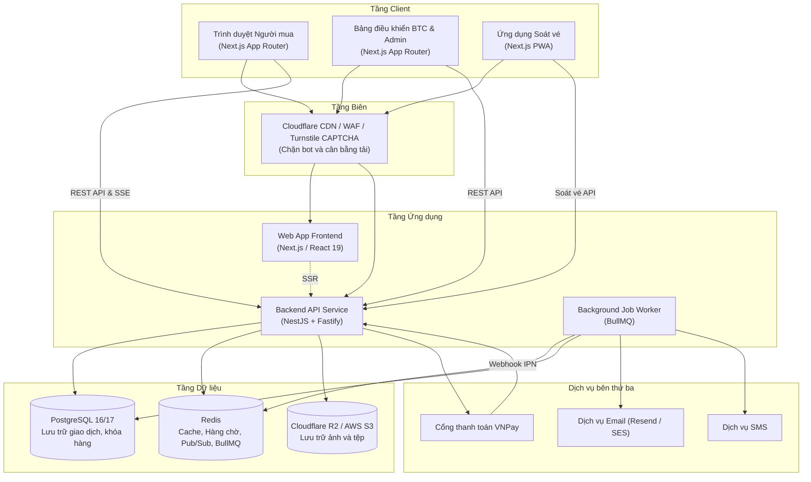
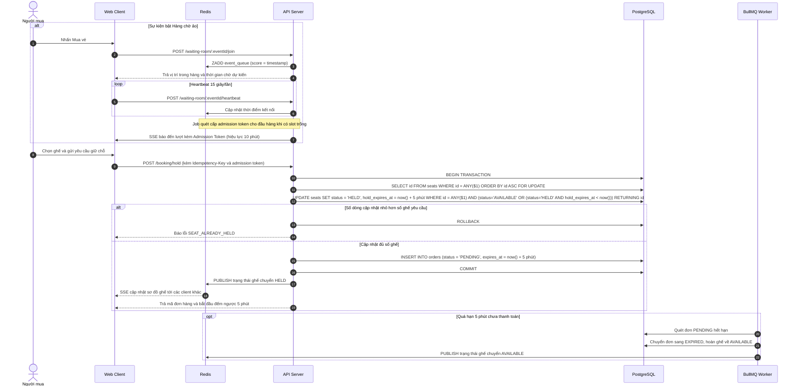
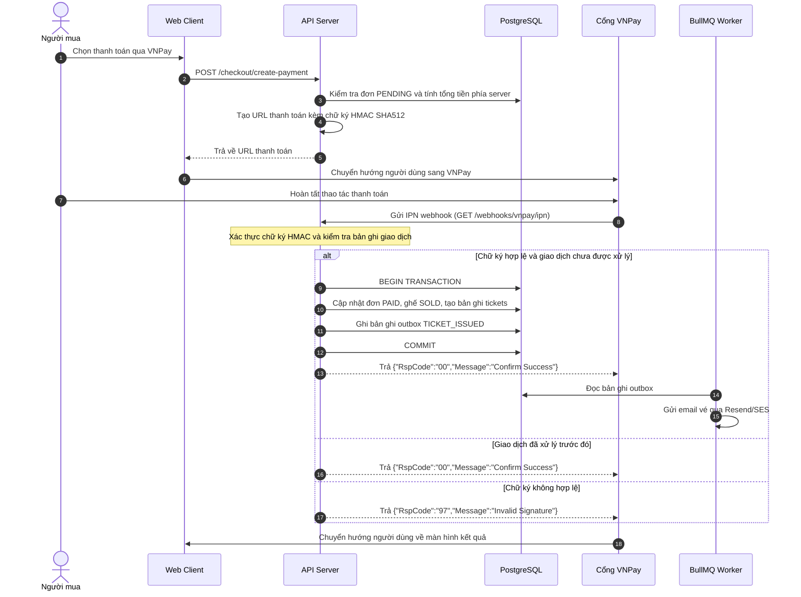
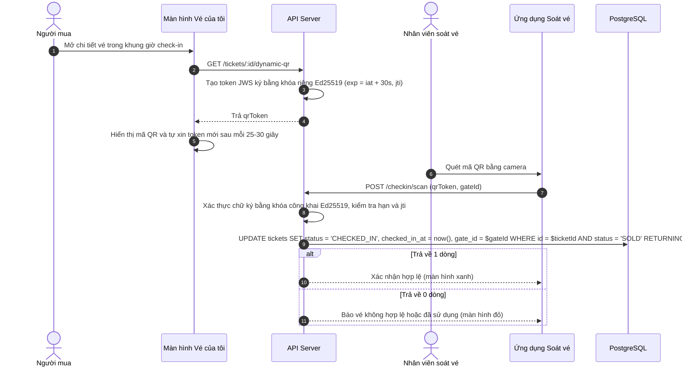

# Kiến trúc hệ thống

Tài liệu này mô tả kiến trúc tổng thể, mô hình phân chia module trong monorepo và các luồng xử lý đồng thời của hệ thống TicketHub.

## Kiến trúc tổng thể

Hệ thống được thiết kế theo mô hình monorepo, chia tách ứng dụng web và API backend, sử dụng PostgreSQL làm nơi lưu trữ trạng thái giao dịch và Redis làm lớp đệm trung gian.

## Cấu trúc thư mục

Kho mã nguồn sử dụng pnpm workspaces để quản lý các gói:

- `apps/web`: Ứng dụng giao diện người dùng xây dựng bằng Next.js App Router, bao gồm trang công khai, trang mua vé, bảng điều khiển ban tổ chức, bảng điều khiển quản trị viên và ứng dụng PWA soát vé.
- `apps/api`: Dịch vụ backend xây dựng bằng NestJS trên nền tảng Fastify. Các module nghiệp vụ được tách biệt (auth, events, seats, booking, waiting-room, payment, ticket, checkin, refund, reporting, admin, notification).
- `packages/shared`: Thư viện dùng chung chứa định nghĩa kiểu dữ liệu TypeScript, schema xác thực Zod và hằng số hệ thống.

## Các luồng xử lý chính

### Giữ chỗ và điều tiết hàng chờ

Khi sự kiện mở bán lượng vé lớn, hàng chờ ảo được kích hoạt để giới hạn số lượng phiên chọn ghế đồng thời không vượt quá ngưỡng `MAX_ACTIVE`.

### Thanh toán qua VNPay và xử lý webhook

### Ký số mã QR động và kiểm soát soát vé

Mã QR hiển thị trên ứng dụng là một token JWS có thời hạn ngắn (30 giây) để giảm nguy cơ chia sẻ ảnh chụp màn hình.

## Các biện pháp an toàn và giới hạn

### Giới hạn gian lận vé

- Cơ chế QR động giới hạn hiệu lực trong 30 giây giúp giảm thiểu việc chia sẻ ảnh chụp màn hình, nhưng không ngăn được việc người dùng đưa trực tiếp thiết bị của họ cho người khác vào cổng.
- Nhân viên soát vé vẫn duy trì quy trình kiểm tra đối chiếu giấy tờ tùy thân khi phát hiện dấu hiệu nghi vấn.

### Dừng khẩn cấp (Kill Switch)

- Khi phát hiện sự kiện vi phạm hoặc có khiếu nại nghiêm trọng, quản trị viên có thể chuyển trạng thái sự kiện sang `SUSPENDED`.
- Hệ thống sẽ chặn các yêu cầu đặt chỗ, thanh toán mới, hủy các đơn đang giữ chỗ và thông báo cho người dùng đang chờ trong hàng.

### Kiểm soát lưu lượng và bảo vệ ứng dụng

- Cloudflare áp dụng tường lửa ứng dụng (WAF) và Turnstile CAPTCHA để hạn chế lưu lượng truy cập từ bot tự động.
- API áp dụng rate limiting theo địa chỉ IP và tài khoản người dùng trên các endpoint nhạy cảm như đăng nhập, giữ chỗ và tạo thanh toán.
