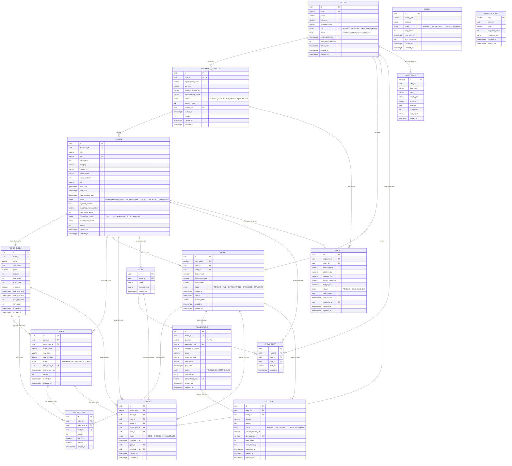

# Thiết Kế Cơ Sở Dữ Liệu & ERD (Entity-Relationship Diagram)
**Dự án:** Nền tảng bán vé sự kiện trực tuyến (TicketHub)  
**Tiêu chuẩn:** PostgreSQL 16/17 · Nguồn sự thật duy nhất (Single Source of Truth) · Khóa mức hàng & Giao dịch nguyên tử  

---

## 1. Sơ Đồ Thực Thể - Quan Hệ (ERD Mermaid)



---

## 2. Đặc Tả Chi Tiết Các Bảng & Ràng Buộc (DDL Specifications)

### 2.1 Bảng `users` (Người dùng hệ thống)
Lưu trữ thông tin tài khoản người dùng của toàn hệ thống (Người mua, Ban tổ chức, Nhân viên soát vé, Quản trị viên).

| Cột | Kiểu dữ liệu | Ràng buộc | Mô tả |
| :--- | :--- | :--- | :--- |
| `id` | `UUID` | `PRIMARY KEY DEFAULT gen_random_uuid()` | Khóa chính duy nhất |
| `email` | `VARCHAR(255)` | `NOT NULL UNIQUE` | Địa chỉ email đăng nhập |
| `phone` | `VARCHAR(20)` | `NULL` | Số điện thoại liên hệ (+84) |
| `full_name` | `VARCHAR(150)` | `NOT NULL` | Họ và tên đầy đủ |
| `password_hash` | `VARCHAR(255)` | `NOT NULL` | Mật khẩu mã hóa Argon2id |
| `role` | `VARCHAR(20)` | `NOT NULL CHECK (role IN ('BUYER', 'ORGANIZER', 'GATE_STAFF', 'ADMIN'))` | Phân quyền RBAC |
| `status` | `VARCHAR(25)` | `NOT NULL DEFAULT 'PENDING_EMAIL' CHECK (status IN ('PENDING_EMAIL', 'ACTIVE', 'LOCKED'))` | Vòng đời tài khoản |
| `email_verified_at`| `TIMESTAMPTZ`| `NULL` | Thời điểm hoàn tất xác thực email |
| `failed_login_attempts` | `INT` | `NOT NULL DEFAULT 0` | Số lần đăng nhập sai liên tiếp |
| `locked_until` | `TIMESTAMPTZ` | `NULL` | Khóa đăng nhập tạm thời (sau 5 lần sai) |
| `created_at` | `TIMESTAMPTZ` | `NOT NULL DEFAULT now()` | Thời điểm tạo bản ghi |
| `updated_at` | `TIMESTAMPTZ` | `NOT NULL DEFAULT now()` | Thời điểm cập nhật cuối |

**Chỉ mục:**
- `CREATE UNIQUE INDEX idx_users_email ON users(email);`
- `CREATE INDEX idx_users_role_status ON users(role, status);`

---

### 2.2 Bảng `organizer_profiles` (Hồ sơ pháp lý Ban Tổ Chức)
Lưu thông tin pháp lý của đơn vị tổ chức, phục vụ việc Admin kiểm duyệt trước khi được phép đăng sự kiện.

| Cột | Kiểu dữ liệu | Ràng buộc | Mô tả |
| :--- | :--- | :--- | :--- |
| `id` | `UUID` | `PRIMARY KEY DEFAULT gen_random_uuid()` | Khóa chính |
| `user_id` | `UUID` | `NOT NULL UNIQUE REFERENCES users(id) ON DELETE CASCADE` | 1-1 với tài khoản user |
| `organization_name`| `VARCHAR(255)` | `NOT NULL` | Tên công ty / đơn vị tổ chức |
| `tax_code` | `VARCHAR(50)` | `NOT NULL` | Mã số thuế doanh nghiệp |
| `business_license_url`| `VARCHAR(500)`| `NOT NULL` | Link ảnh GPKD trên Cloudflare R2/S3 |
| `representative_name`| `VARCHAR(150)`| `NOT NULL` | Tên người đại diện pháp luật |
| `status` | `VARCHAR(25)` | `NOT NULL DEFAULT 'PENDING_VERIFICATION' CHECK (status IN ('PENDING_VERIFICATION', 'VERIFIED', 'REJECTED'))` | Trạng thái xác minh hồ sơ |
| `rejection_reason` | `TEXT` | `NULL` | Lý do Admin từ chối phê duyệt |
| `verified_by` | `UUID` | `NULL REFERENCES users(id)` | ID của Admin duyệt |
| `verified_at` | `TIMESTAMPTZ` | `NULL` | Thời điểm duyệt |
| `version` | `INT` | `NOT NULL DEFAULT 1` | Optimistic locking |
| `created_at` | `TIMESTAMPTZ` | `NOT NULL DEFAULT now()` | |
| `updated_at` | `TIMESTAMPTZ` | `NOT NULL DEFAULT now()` | |

---

### 2.3 Bảng `events` (Sự kiện)
Lưu trữ thông tin chương trình, địa điểm, chính sách vé và cấu hình hàng chờ ảo.

| Cột | Kiểu dữ liệu | Ràng buộc | Mô tả |
| :--- | :--- | :--- | :--- |
| `id` | `UUID` | `PRIMARY KEY DEFAULT gen_random_uuid()` | Khóa chính |
| `organizer_id` | `UUID` | `NOT NULL REFERENCES organizer_profiles(id)` | Chủ sự kiện |
| `title` | `VARCHAR(255)` | `NOT NULL` | Tên sự kiện |
| `slug` | `VARCHAR(255)` | `NOT NULL UNIQUE` | URL-friendly slug SEO |
| `description` | `TEXT` | `NOT NULL` | Nội dung mô tả chi tiết |
| `category` | `VARCHAR(50)` | `NOT NULL` | Ca nhạc, Hội thảo, Thể thao,... |
| `banner_url` | `VARCHAR(500)` | `NOT NULL` | Ảnh đại diện sự kiện (R2/S3) |
| `venue_name` | `VARCHAR(255)` | `NOT NULL` | Tên địa điểm tổ chức |
| `venue_address`| `TEXT` | `NOT NULL` | Địa chỉ cụ thể |
| `city` | `VARCHAR(100)` | `NOT NULL` | Hà Nội, TP.HCM, Đà Nẵng,... |
| `start_time` | `TIMESTAMPTZ` | `NOT NULL` | Giờ bắt đầu sự kiện |
| `end_time` | `TIMESTAMPTZ` | `NOT NULL CHECK (end_time > start_time)` | Giờ kết thúc sự kiện |
| `gate_opening_time`| `TIMESTAMPTZ`| `NOT NULL CHECK (gate_opening_time <= start_time)` | Giờ mở cổng soát vé |
| `status` | `VARCHAR(25)` | `NOT NULL DEFAULT 'DRAFT' CHECK (status IN ('DRAFT', 'PENDING_APPROVAL', 'PUBLISHED', 'ENDED', 'CANCELLED', 'SUSPENDED'))` | Vòng đời sự kiện |
| `rejection_reason` | `TEXT` | `NULL` | Lý do từ chối kiểm duyệt |
| `is_waiting_room_enabled`| `BOOLEAN`| `NOT NULL DEFAULT false`| Bật/tắt hàng chờ ảo (UC03) |
| `max_active_users` | `INT` | `NOT NULL DEFAULT 200` | Ngưỡng user chọn ghế đồng thời |
| `refund_policy_type` | `VARCHAR(25)` | `NOT NULL DEFAULT 'FLEXIBLE' CHECK (refund_policy_type IN ('STRICT', 'FLEXIBLE', 'CUSTOM', 'NO_REFUND'))` | Chính sách hoàn |
| `refund_policy_rules` | `JSONB` | `NOT NULL DEFAULT '[]'::jsonb` | Mốc thời gian & tỷ lệ hoàn % |
| `version` | `INT` | `NOT NULL DEFAULT 1` | Optimistic locking |
| `created_at` | `TIMESTAMPTZ` | `NOT NULL DEFAULT now()` | |
| `updated_at` | `TIMESTAMPTZ` | `NOT NULL DEFAULT now()` | |

**Chỉ mục tìm kiếm Full-Text:**
```sql
CREATE EXTENSION IF NOT EXISTS unaccent;
CREATE INDEX idx_events_fts ON events USING gin (
    to_tsvector('simple', unaccent(title || ' ' || description || ' ' || venue_name || ' ' || city))
);
CREATE INDEX idx_events_search_filters ON events(city, category, start_time, status);
```

---

### 2.4 Bảng `ticket_types` (Hạng vé)
Phân hạng vé và định giá (VIP, Thường, Early Bird, Khu đứng GA).

| Cột | Kiểu dữ liệu | Ràng buộc | Mô tả |
| :--- | :--- | :--- | :--- |
| `id` | `UUID` | `PRIMARY KEY DEFAULT gen_random_uuid()` | Khóa chính |
| `event_id` | `UUID` | `NOT NULL REFERENCES events(id) ON DELETE CASCADE` | Sự kiện |
| `name` | `VARCHAR(100)` | `NOT NULL` | Tên hạng vé (VIP 1, Zone A, GA) |
| `description` | `TEXT` | `NULL` | Quyền lợi hạng vé |
| `price` | `NUMERIC(14,2)`| `NOT NULL CHECK (price >= 0)` | Đơn giá VNĐ |
| `capacity` | `INT` | `NOT NULL CHECK (capacity > 0)` | Tổng số vé phát hành của hạng |
| `held_count` | `INT` | `NOT NULL DEFAULT 0 CHECK (held_count >= 0)` | Số vé đang được giữ tạm |
| `sold_count` | `INT` | `NOT NULL DEFAULT 0 CHECK (sold_count >= 0)` | Số vé đã thanh toán thành công |
| `is_seated` | `BOOLEAN` | `NOT NULL DEFAULT true` | true = Ghế số; false = Khu đứng GA |
| `sale_start_time`| `TIMESTAMPTZ`| `NOT NULL` | Giờ mở bán vé |
| `sale_end_time` | `TIMESTAMPTZ` | `NOT NULL CHECK (sale_end_time > sale_start_time)` | Giờ đóng bán vé |
| `max_per_order` | `INT` | `NOT NULL DEFAULT 6 CHECK (max_per_order > 0)` | Giới hạn vé/đơn (mặc định 6) |
| `sort_order` | `INT` | `NOT NULL DEFAULT 0` | Thứ tự hiển thị |
| `created_at` | `TIMESTAMPTZ` | `NOT NULL DEFAULT now()` | |
| `updated_at` | `TIMESTAMPTZ` | `NOT NULL DEFAULT now()` | |

**Ràng buộc tổng tồn kho:**
```sql
ALTER TABLE ticket_types ADD CONSTRAINT chk_ticket_capacity 
CHECK (sold_count + held_count <= capacity);
```

---

### 2.5 Bảng `seats` (Ghế ngồi trên sơ đồ)
Quản lý từng vị trí ghế cụ thể cho các sự kiện có số ghế. Là trọng tâm của cơ chế giữ chỗ nguyên tử 5 phút.

| Cột | Kiểu dữ liệu | Ràng buộc | Mô tả |
| :--- | :--- | :--- | :--- |
| `id` | `UUID` | `PRIMARY KEY DEFAULT gen_random_uuid()` | Khóa chính |
| `event_id` | `UUID` | `NOT NULL REFERENCES events(id) ON DELETE CASCADE` | Sự kiện |
| `ticket_type_id`| `UUID` | `NOT NULL REFERENCES ticket_types(id)` | Thuộc hạng vé nào |
| `zone_name` | `VARCHAR(50)` | `NOT NULL` | Khán đài / Khu vực (A, B, Khán đài Tây) |
| `row_label` | `VARCHAR(20)` | `NOT NULL` | Hàng ghế (Hàng 1, Hàng A) |
| `seat_number` | `VARCHAR(20)` | `NOT NULL` | Số ghế (Ghế 01, Ghế 15) |
| `status` | `VARCHAR(20)` | `NOT NULL DEFAULT 'AVAILABLE' CHECK (status IN ('AVAILABLE', 'HELD', 'SOLD', 'BLOCKED'))` | Trạng thái ghế |
| `hold_order_id` | `UUID` | `NULL` | ID đơn hàng đang giữ ghế |
| `hold_expires_at`| `TIMESTAMPTZ`| `NULL` | Hạn chót giữ chỗ (now() + 5 phút) |
| `version` | `INT` | `NOT NULL DEFAULT 1` | Optimistic locking |
| `created_at` | `TIMESTAMPTZ` | `NOT NULL DEFAULT now()` | |
| `updated_at` | `TIMESTAMPTZ` | `NOT NULL DEFAULT now()` | |

**Ràng buộc Unique chống trùng ghế vật lý:**
```sql
CREATE UNIQUE INDEX idx_seats_unique_position 
ON seats(event_id, zone_name, row_label, seat_number);

CREATE INDEX idx_seats_event_status ON seats(event_id, status);
CREATE INDEX idx_seats_hold_expiry ON seats(status, hold_expires_at) WHERE status = 'HELD';
```

---

### 2.6 Bảng `orders` (Đơn hàng)
Lưu trữ thông tin giao dịch mua vé của người dùng.

| Cột | Kiểu dữ liệu | Ràng buộc | Mô tả |
| :--- | :--- | :--- | :--- |
| `id` | `UUID` | `PRIMARY KEY DEFAULT gen_random_uuid()` | Khóa chính |
| `order_code` | `VARCHAR(32)` | `NOT NULL UNIQUE` | Mã đơn hàng (VD: ORD-20261014-ABC12) |
| `user_id` | `UUID` | `NOT NULL REFERENCES users(id)` | Người mua |
| `event_id` | `UUID` | `NOT NULL REFERENCES events(id)` | Sự kiện đặt vé |
| `total_amount` | `NUMERIC(14,2)`| `NOT NULL CHECK (total_amount >= 0)` | Tổng giá trị gốc |
| `discount_amount`| `NUMERIC(14,2)`| `NOT NULL DEFAULT 0 CHECK (discount_amount >= 0)`| Số tiền giảm giá |
| `final_amount` | `NUMERIC(14,2)`| `NOT NULL CHECK (final_amount >= 0)` | Số tiền thực phải thanh toán |
| `status` | `VARCHAR(20)` | `NOT NULL DEFAULT 'PENDING' CHECK (status IN ('PENDING', 'PAID', 'EXPIRED', 'FAILED', 'CANCELLED', 'REFUNDED'))` | Vòng đời đơn hàng |
| `expires_at` | `TIMESTAMPTZ` | `NOT NULL` | Thời hạn thanh toán (5 phút kể từ khi tạo) |
| `paid_at` | `TIMESTAMPTZ` | `NULL` | Thời điểm nhận IPN thành công |
| `voucher_code` | `VARCHAR(50)` | `NULL` | Mã giảm giá áp dụng |
| `created_at` | `TIMESTAMPTZ` | `NOT NULL DEFAULT now()` | |
| `updated_at` | `TIMESTAMPTZ` | `NOT NULL DEFAULT now()` | |

**Ràng buộc chỉ 1 phiên đặt vé còn hạn/tài khoản/sự kiện:**
```sql
CREATE INDEX idx_orders_user_pending 
ON orders(user_id, event_id, status) WHERE status = 'PENDING';
```

---

### 2.7 Bảng `order_items` (Chi tiết đơn hàng)
Chi tiết các hạng vé và ghế cụ thể được chọn trong đơn.

| Cột | Kiểu dữ liệu | Ràng buộc | Mô tả |
| :--- | :--- | :--- | :--- |
| `id` | `UUID` | `PRIMARY KEY DEFAULT gen_random_uuid()` | Khóa chính |
| `order_id` | `UUID` | `NOT NULL REFERENCES orders(id) ON DELETE CASCADE` | Thuộc đơn hàng |
| `ticket_type_id`| `UUID` | `NOT NULL REFERENCES ticket_types(id)` | Hạng vé |
| `seat_id` | `UUID` | `NULL REFERENCES seats(id)` | Ghế cụ thể (NULL nếu khu đứng GA) |
| `quantity` | `INT` | `NOT NULL CHECK (quantity > 0)` | Số lượng (1 nếu có ghế) |
| `unit_price` | `NUMERIC(14,2)`| `NOT NULL CHECK (unit_price >= 0)` | Đơn giá tại thời điểm mua |
| `subtotal` | `NUMERIC(14,2)`| `NOT NULL CHECK (subtotal >= 0)` | Thành tiền mục |
| `created_at` | `TIMESTAMPTZ` | `NOT NULL DEFAULT now()` | |

---

### 2.8 Bảng `tickets` (Vé điện tử phát hành)
Bản ghi vé chính thức được cấp phát sau khi thanh toán thành công, phục vụ quét mã QR vào cổng.

| Cột | Kiểu dữ liệu | Ràng buộc | Mô tả |
| :--- | :--- | :--- | :--- |
| `id` | `UUID` | `PRIMARY KEY DEFAULT gen_random_uuid()` | Khóa chính vé (đưa vào payload JWT) |
| `ticket_code` | `VARCHAR(32)` | `NOT NULL UNIQUE` | Mã vé dự phòng tra cứu thủ công (VD: TKT-XYZ789) |
| `order_id` | `UUID` | `NOT NULL REFERENCES orders(id)` | Đơn hàng tạo ra vé |
| `user_id` | `UUID` | `NOT NULL REFERENCES users(id)` | Chủ sở hữu vé hiện tại |
| `event_id` | `UUID` | `NOT NULL REFERENCES events(id)` | Sự kiện |
| `ticket_type_id`| `UUID` | `NOT NULL REFERENCES ticket_types(id)` | Hạng vé |
| `seat_id` | `UUID` | `NULL REFERENCES seats(id)` | Vị trí ghế ngồi (nếu có) |
| `status` | `VARCHAR(20)` | `NOT NULL DEFAULT 'SOLD' CHECK (status IN ('SOLD', 'CHECKED_IN', 'CANCELLED'))` | Trạng thái vé |
| `checked_in_at` | `TIMESTAMPTZ` | `NULL` | Thời điểm soát vé thành công |
| `gate_id` | `UUID` | `NULL REFERENCES gates(id)` | Cổng quét vé |
| `checked_in_by` | `UUID` | `NULL REFERENCES users(id)` | Nhân viên soát vé thực hiện quét |
| `created_at` | `TIMESTAMPTZ` | `NOT NULL DEFAULT now()` | |
| `updated_at` | `TIMESTAMPTZ` | `NOT NULL DEFAULT now()` | |

**Ràng buộc bảo vệ cấp database chống bán trùng vé:**
```sql
CREATE UNIQUE INDEX idx_tickets_unique_active_seat 
ON tickets(event_id, seat_id) 
WHERE seat_id IS NOT NULL AND status != 'CANCELLED';
```

---

### 2.9 Bảng `transactions` (Giao dịch cổng thanh toán VNPay)
Ghi nhận toàn bộ yêu cầu thanh toán và phản hồi IPN từ VNPay, xử lý Idempotency.

| Cột | Kiểu dữ liệu | Ràng buộc | Mô tả |
| :--- | :--- | :--- | :--- |
| `id` | `UUID` | `PRIMARY KEY DEFAULT gen_random_uuid()` | Khóa chính |
| `order_id` | `UUID` | `NOT NULL REFERENCES orders(id)` | Đơn hàng thanh toán |
| `provider` | `VARCHAR(20)` | `NOT NULL DEFAULT 'VNPAY'` | Cổng thanh toán |
| `transaction_ref`| `VARCHAR(100)`| `NOT NULL UNIQUE` | Mã tham chiếu gửi sang cổng (vnp_TxnRef) |
| `provider_tx_number`| `VARCHAR(100)`| `NULL` | Mã giao dịch phía VNPay (vnp_TransactionNo) |
| `amount` | `NUMERIC(14,2)`| `NOT NULL CHECK (amount > 0)` | Số tiền giao dịch |
| `response_code` | `VARCHAR(10)` | `NULL` | Mã kết quả VNPay (00 = thành công) |
| `bank_code` | `VARCHAR(20)` | `NULL` | Ngân hàng thanh toán |
| `pay_date` | `TIMESTAMPTZ` | `NULL` | Thời điểm thanh toán ghi nhận tại cổng |
| `status` | `VARCHAR(20)` | `NOT NULL DEFAULT 'PENDING' CHECK (status IN ('PENDING', 'SUCCESS', 'FAILED'))` | Trạng thái giao dịch |
| `raw_callback` | `JSONB` | `NULL` | Toàn bộ payload IPN để đối soát |
| `idempotency_key`| `VARCHAR(100)`| `NOT NULL UNIQUE` | Khóa chống xử lý trùng lặp |
| `created_at` | `TIMESTAMPTZ` | `NOT NULL DEFAULT now()` | |
| `updated_at` | `TIMESTAMPTZ` | `NOT NULL DEFAULT now()` | |

**Chỉ mục chống callback trùng:**
```sql
CREATE UNIQUE INDEX idx_transactions_provider_unique 
ON transactions(provider, provider_tx_number) 
WHERE provider_tx_number IS NOT NULL;
```

---

### 2.10 Bảng `refunds` (Hoàn tiền)
Ghi nhận các yêu cầu hoàn vé theo chính sách hoặc hoàn tiền do sự kiện bị hủy.

| Cột | Kiểu dữ liệu | Ràng buộc | Mô tả |
| :--- | :--- | :--- | :--- |
| `id` | `UUID` | `PRIMARY KEY DEFAULT gen_random_uuid()` | Khóa chính |
| `order_id` | `UUID` | `NOT NULL REFERENCES orders(id)` | Đơn hàng hoàn tiền |
| `ticket_id` | `UUID` | `NULL REFERENCES tickets(id)` | Vé bị hủy (nếu hoàn lẻ) |
| `amount` | `NUMERIC(14,2)`| `NOT NULL CHECK (amount > 0)` | Số tiền hoàn lại cho người mua |
| `reason` | `TEXT` | `NOT NULL` | Lý do hoàn tiền |
| `status` | `VARCHAR(20)` | `NOT NULL DEFAULT 'PENDING' CHECK (status IN ('PENDING', 'PROCESSING', 'COMPLETED', 'FAILED'))` | Tiến độ xử lý hoàn tiền |
| `provider_refund_ref`| `VARCHAR(100)`| `NULL` | Mã phản hồi hoàn tiền của VNPay |
| `idempotency_key`| `VARCHAR(100)`| `NOT NULL UNIQUE` | Khóa chống trùng gọi API cổng |
| `retry_count` | `INT` | `NOT NULL DEFAULT 0` | Số lần thử lại qua worker |
| `error_message` | `TEXT` | `NULL` | Thông tin lỗi nếu thất bại |
| `processed_at` | `TIMESTAMPTZ` | `NULL` | Thời điểm hoàn tất hoàn tiền |
| `created_at` | `TIMESTAMPTZ` | `NOT NULL DEFAULT now()` | |
| `updated_at` | `TIMESTAMPTZ` | `NOT NULL DEFAULT now()` | |

---

### 2.11 Bảng `gates` & `event_staff` (Hạ tầng cổng soát vé & Phân công)

**Bảng `gates`:**
- `id` (UUID PK), `event_id` (UUID FK), `name` (VARCHAR: Cổng A, Cổng B, Cổng VIP), `location_desc` (VARCHAR).

**Bảng `event_staff`:**
- `id` (UUID PK), `event_id` (UUID FK), `user_id` (UUID FK), `gate_id` (UUID FK), `staff_role` (VARCHAR: SCANNER, SUPERVISOR).
- `CREATE UNIQUE INDEX idx_staff_event_user ON event_staff(event_id, user_id);`

---

### 2.12 Bảng `payouts` (Đối soát & Quyết toán chi trả Ban Tổ Chức)
Theo dõi các đợt thanh toán doanh thu từ nền tảng về tài khoản ngân hàng của BTC.

| Cột | Kiểu dữ liệu | Ràng buộc | Mô tả |
| :--- | :--- | :--- | :--- |
| `id` | `UUID` | `PRIMARY KEY DEFAULT gen_random_uuid()` | Khóa chính |
| `organizer_id` | `UUID` | `NOT NULL REFERENCES organizer_profiles(id)` | Ban tổ chức |
| `event_id` | `UUID` | `NOT NULL REFERENCES events(id)` | Sự kiện đối soát |
| `total_revenue` | `NUMERIC(14,2)`| `NOT NULL` | Tổng doanh thu bán vé gộp |
| `platform_fee` | `NUMERIC(14,2)`| `NOT NULL` | Phí dịch vụ nền tảng khấu trừ |
| `gateway_fee` | `NUMERIC(14,2)`| `NOT NULL` | Phí cổng VNPay khấu trừ |
| `refund_deduction`| `NUMERIC(14,2)`| `NOT NULL` | Tổng tiền đã hoàn trừ lại |
| `net_payout` | `NUMERIC(14,2)`| `NOT NULL` | Số tiền thực chi trả cho BTC |
| `status` | `VARCHAR(20)` | `NOT NULL DEFAULT 'PENDING' CHECK (status IN ('PENDING', 'HOLD', 'PAID_OUT'))` | Trạng thái chi trả |
| `hold_reason` | `TEXT` | `NULL` | Lý do tạm giữ tiền (nếu có tranh chấp) |
| `paid_out_at` | `TIMESTAMPTZ` | `NULL` | Thời điểm chuyển khoản thực tế |
| `approved_by` | `UUID` | `NULL REFERENCES users(id)` | Admin phê duyệt lệnh chi trả |
| `created_at` | `TIMESTAMPTZ` | `NOT NULL DEFAULT now()` | |
| `updated_at` | `TIMESTAMPTZ` | `NOT NULL DEFAULT now()` | |

---

### 2.13 Bảng Kỹ Thuật: `audit_log`, `outbox`, `idempotency_keys`

#### Bảng `audit_log` (Nhật ký kiểm toán bất biến - INSERT Only)
```sql
CREATE TABLE audit_log (
    id BIGSERIAL PRIMARY KEY,
    actor_id UUID NULL,
    actor_role VARCHAR(20) NOT NULL,
    action VARCHAR(100) NOT NULL,
    target_type VARCHAR(50) NOT NULL,
    target_id VARCHAR(100) NOT NULL,
    changes JSONB NULL,
    ip_address INET NULL,
    user_agent VARCHAR(255) NULL,
    created_at TIMESTAMPTZ NOT NULL DEFAULT now()
);

-- Phân quyền cơ sở dữ liệu: Ngăn chặn UPDATE và DELETE
REVOKE UPDATE, DELETE ON audit_log FROM PUBLIC;
```

#### Bảng `outbox` (Mẫu thiết kế Transactional Outbox)
```sql
CREATE TABLE outbox (
    id UUID PRIMARY KEY DEFAULT gen_random_uuid(),
    event_type VARCHAR(100) NOT NULL, -- TICKET_ISSUED, PAYMENT_CONFIRMED, EVENT_APPROVED
    payload JSONB NOT NULL,
    status VARCHAR(20) NOT NULL DEFAULT 'PENDING' CHECK (status IN ('PENDING', 'PROCESSING', 'COMPLETED', 'FAILED')),
    retry_count INT NOT NULL DEFAULT 0,
    next_retry_at TIMESTAMPTZ NOT NULL DEFAULT now(),
    error_message TEXT NULL,
    created_at TIMESTAMPTZ NOT NULL DEFAULT now(),
    updated_at TIMESTAMPTZ NOT NULL DEFAULT now()
);
CREATE INDEX idx_outbox_fetch ON outbox(status, next_retry_at) WHERE status IN ('PENDING', 'PROCESSING');
```

#### Bảng `idempotency_keys` (Chống lặp thao tác API quan trọng)
```sql
CREATE TABLE idempotency_keys (
    key VARCHAR(100) PRIMARY KEY,
    user_id UUID NOT NULL,
    path VARCHAR(255) NOT NULL,
    response_status INT NULL,
    response_body JSONB NULL,
    created_at TIMESTAMPTZ NOT NULL DEFAULT now(),
    expires_at TIMESTAMPTZ NOT NULL
);
CREATE INDEX idx_idempotency_expiry ON idempotency_keys(expires_at);
```

---

## 3. Các Truy Vấn Đồng Thời Cốt Lõi (Core Concurrency SQL)

### 3.1 Thủ Tục Giữ Chỗ Ghế 5 Phút (UC04)
```sql
-- Chạy trong một Transaction đơn lẻ (BEGIN ... COMMIT)
BEGIN;

-- Bước 1: Khóa các hàng ghế theo thứ tự ID tăng dần để ngăn ngừa triệt để hiện tượng Deadlock
SELECT id, status, hold_expires_at 
FROM seats
WHERE id = ANY($1::uuid[]) AND event_id = $2
ORDER BY id ASC
FOR UPDATE;

-- Bước 2: Cập nhật có điều kiện nguyên tử
-- Chỉ cho phép giữ những ghế đang AVAILABLE hoặc ghế HELD đã quá hạn 5 phút
UPDATE seats
SET status = 'HELD',
    hold_order_id = $3,
    hold_expires_at = now() + interval '5 minutes',
    version = version + 1,
    updated_at = now()
WHERE id = ANY($1::uuid[])
  AND event_id = $2
  AND (status = 'AVAILABLE' OR (status = 'HELD' AND hold_expires_at < now()))
RETURNING id;

-- Bước 3: Đếm số dòng trả về từ bước 2
-- NẾU count(returned_ids) < array_length($1::uuid[], 1):
--   -> ROLLBACK;
--   -> Báo lỗi SEAT_ALREADY_HELD hoặc SEAT_UNAVAILABLE.
-- NGƯỢC LẠI:
--   -> INSERT INTO orders (id, user_id, event_id, total_amount, ..., expires_at = now() + interval '5 minutes');
--   -> INSERT INTO order_items (...);
--   -> COMMIT;
```

### 3.2 Giữ Chỗ Khu Đứng (GA)
```sql
UPDATE ticket_types
SET held_count = held_count + $2,
    updated_at = now()
WHERE id = $1
  AND sold_count + held_count + $2 <= capacity
RETURNING id;
-- Nếu không có dòng nào được cập nhật -> Hết vé khu đứng -> Rollback.
```

### 3.3 Soát Vé Check-In Nguyên Tử (UC08)
```sql
-- Lệnh check-in nguyên tử chỉ thành công đúng 1 lần duy nhất cho mỗi vé
UPDATE tickets
SET status = 'CHECKED_IN',
    checked_in_at = now(),
    gate_id = $2,
    checked_in_by = $3,
    updated_at = now()
WHERE id = $1 
  AND status = 'SOLD'
RETURNING id, ticket_code, seat_id;
-- Nếu trả về đúng 1 dòng: CHECK-IN HỢP LỆ (Màn hình xanh)
-- Nếu trả về 0 dòng: VÉ ĐÃ DÙNG HOẶC ĐÃ HỦY (Màn hình đỏ cảnh báo)
```

---

## 4. Bảng Tổng Hợp Báo Cáo (Materialized Views)
Để tránh ảnh hưởng tới hiệu năng các bảng giao dịch khi BTC xem báo cáo (UC09):

```sql
CREATE MATERIALIZED VIEW mv_event_sales_summary AS
SELECT 
    e.id AS event_id,
    e.organizer_id,
    e.title,
    count(DISTINCT t.id) FILTER (WHERE t.status IN ('SOLD', 'CHECKED_IN')) AS total_sold_tickets,
    count(DISTINCT t.id) FILTER (WHERE t.status = 'CHECKED_IN') AS total_checked_in_tickets,
    coalesce(sum(oi.subtotal) FILTER (WHERE o.status = 'PAID'), 0) AS gross_revenue,
    coalesce(sum(r.amount) FILTER (WHERE r.status = 'COMPLETED'), 0) AS total_refunded_amount,
    now() AS refreshed_at
FROM events e
LEFT JOIN orders o ON o.event_id = e.id AND o.status = 'PAID'
LEFT JOIN order_items oi ON oi.order_id = o.id
LEFT JOIN tickets t ON t.event_id = e.id
LEFT JOIN refunds r ON r.order_id = o.id AND r.status = 'COMPLETED'
GROUP BY e.id, e.organizer_id, e.title;

CREATE UNIQUE INDEX idx_mv_event_sales_id ON mv_event_sales_summary(event_id);

-- Job nền BullMQ gọi lệnh làm mới không khóa bảng mỗi 5 phút:
-- REFRESH MATERIALIZED VIEW CONCURRENTLY mv_event_sales_summary;
```
