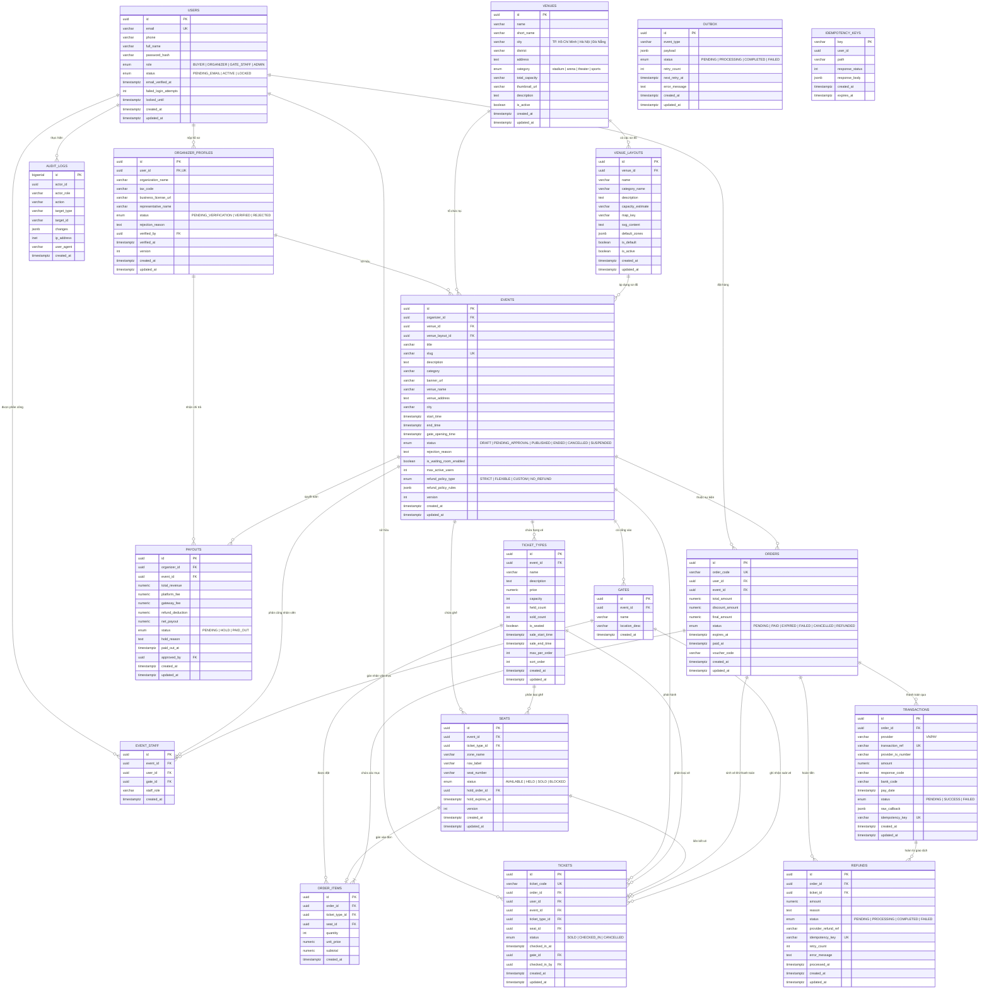

# Thiết kế cơ sở dữ liệu

Tài liệu này đặc tả lược đồ quan hệ, các ràng buộc toàn vẹn và cơ chế kiểm soát tranh chấp dữ liệu trên PostgreSQL 16/17 cho hệ thống TicketHub.

## Sơ đồ quan hệ thực thể



## Đặc tả các bảng

### users

Lưu trữ tài khoản người dùng của các vai trò trong hệ thống.

| Cột                   | Kiểu         | Ràng buộc                                                                                | Diễn giải                        |
| :-------------------- | :----------- | :--------------------------------------------------------------------------------------- | :------------------------------- |
| id                    | UUID         | PRIMARY KEY DEFAULT gen_random_uuid()                                                    | Khóa chính                       |
| email                 | VARCHAR(255) | NOT NULL UNIQUE                                                                          | Email đăng nhập                  |
| phone                 | VARCHAR(20)  | NULL                                                                                     | Số điện thoại                    |
| full_name             | VARCHAR(150) | NOT NULL                                                                                 | Họ và tên                        |
| password_hash         | VARCHAR(255) | NOT NULL                                                                                 | Mật khẩu mã hóa Argon2id         |
| role                  | VARCHAR(20)  | NOT NULL CHECK (role IN ('BUYER', 'ORGANIZER', 'GATE_STAFF', 'ADMIN'))                   | Vai trò người dùng               |
| status                | VARCHAR(25)  | NOT NULL DEFAULT 'PENDING_EMAIL' CHECK (status IN ('PENDING_EMAIL', 'ACTIVE', 'LOCKED')) | Trạng thái tài khoản             |
| email_verified_at     | TIMESTAMPTZ  | NULL                                                                                     | Thời điểm xác thực email         |
| failed_login_attempts | INT          | NOT NULL DEFAULT 0                                                                       | Số lần đăng nhập sai liên tiếp   |
| locked_until          | TIMESTAMPTZ  | NULL                                                                                     | Thời điểm hết hạn khóa tài khoản |
| created_at            | TIMESTAMPTZ  | NOT NULL DEFAULT now()                                                                   | Thời điểm tạo                    |
| updated_at            | TIMESTAMPTZ  | NOT NULL DEFAULT now()                                                                   | Thời điểm cập nhật cuối          |

Chỉ mục:

- `CREATE UNIQUE INDEX idx_users_email ON users(email);`
- `CREATE INDEX idx_users_role_status ON users(role, status);`

### organizer_profiles

Lưu hồ sơ pháp lý của ban tổ chức để quản trị viên kiểm duyệt.

| Cột                  | Kiểu         | Ràng buộc                                                                                                  | Diễn giải                                 |
| :------------------- | :----------- | :--------------------------------------------------------------------------------------------------------- | :---------------------------------------- |
| id                   | UUID         | PRIMARY KEY DEFAULT gen_random_uuid()                                                                      | Khóa chính                                |
| user_id              | UUID         | NOT NULL UNIQUE REFERENCES users(id) ON DELETE CASCADE                                                     | Khóa ngoại người dùng                     |
| organization_name    | VARCHAR(255) | NOT NULL                                                                                                   | Tên đơn vị tổ chức                        |
| tax_code             | VARCHAR(50)  | NOT NULL                                                                                                   | Mã số thuế                                |
| business_license_url | VARCHAR(500) | NOT NULL                                                                                                   | Đường dẫn giấy phép kinh doanh trên S3/R2 |
| representative_name  | VARCHAR(150) | NOT NULL                                                                                                   | Người đại diện theo pháp luật             |
| status               | VARCHAR(25)  | NOT NULL DEFAULT 'PENDING_VERIFICATION' CHECK (status IN ('PENDING_VERIFICATION', 'VERIFIED', 'REJECTED')) | Trạng thái phê duyệt                      |
| rejection_reason     | TEXT         | NULL                                                                                                       | Lý do từ chối hồ sơ                       |
| verified_by          | UUID         | NULL REFERENCES users(id)                                                                                  | Quản trị viên kiểm duyệt                  |
| verified_at          | TIMESTAMPTZ  | NULL                                                                                                       | Thời điểm phê duyệt                       |
| version              | INT          | NOT NULL DEFAULT 1                                                                                         | Phiên bản dùng cho optimistic locking     |
| created_at           | TIMESTAMPTZ  | NOT NULL DEFAULT now()                                                                                     | Thời điểm tạo                             |
| updated_at           | TIMESTAMPTZ  | NOT NULL DEFAULT now()                                                                                     | Thời điểm cập nhật cuối                   |

### venues

Lưu thông tin các địa điểm tổ chức sự kiện tiêu chuẩn (Curated Venues) đã được quản trị viên kiểm duyệt tại 3 thành phố lớn: TP. Hồ Chí Minh, Hà Nội và Đà Nẵng.

| Cột            | Kiểu         | Ràng buộc                                                                                           | Diễn giải                               |
| :------------- | :----------- | :-------------------------------------------------------------------------------------------------- | :-------------------------------------- |
| id             | UUID         | PRIMARY KEY DEFAULT gen_random_uuid()                                                               | Khóa chính                              |
| name           | VARCHAR(255) | NOT NULL                                                                                            | Tên đầy đủ của địa điểm                 |
| short_name     | VARCHAR(100) | NOT NULL                                                                                            | Tên gọi rút gọn hoặc viết tắt           |
| city           | VARCHAR(50)  | NOT NULL CHECK (city IN ('TP. Hồ Chí Minh', 'Hà Nội', 'Đà Nẵng'))                                   | Thành phố trực thuộc trung ương         |
| district       | VARCHAR(100) | NOT NULL                                                                                            | Quận / Huyện                            |
| address        | TEXT         | NOT NULL                                                                                            | Địa chỉ số nhà và tên đường             |
| category       | VARCHAR(50)  | NOT NULL CHECK (category IN ('stadium', 'arena', 'theater', 'sports'))                              | Loại hình không gian                    |
| total_capacity | VARCHAR(50)  | NOT NULL                                                                                            | Sức chứa tổng thể ước tính              |
| thumbnail_url  | VARCHAR(500) | NULL                                                                                                | Đường dẫn ảnh đại diện địa điểm         |
| description    | TEXT         | NULL                                                                                                | Giới thiệu cơ sở vật chất và tiện ích   |
| is_active      | BOOLEAN      | NOT NULL DEFAULT true                                                                               | Trạng thái khả dụng để ban tổ chức chọn |
| created_at     | TIMESTAMPTZ  | NOT NULL DEFAULT now()                                                                              | Thời điểm tạo                           |
| updated_at     | TIMESTAMPTZ  | NOT NULL DEFAULT now()                                                                              | Thời điểm cập nhật cuối                 |

Chỉ mục:

```sql
CREATE INDEX idx_venues_city_category ON venues(city, category) WHERE is_active = true;
CREATE INDEX idx_venues_fts ON venues USING gin (
    to_tsvector('simple', unaccent(name || ' ' || short_name || ' ' || district || ' ' || address))
);
```

### venue_layouts

Lưu trữ các cấu hình sân khấu và sơ đồ khán đài kiến trúc chuẩn dạng SVG (Live Concert T-stage, Mega Concert, Sân bóng đá, Sàn thi đấu thể thao, Khán phòng nhà hát) liên kết với từng địa điểm tổ chức.

| Cột               | Kiểu         | Ràng buộc                                            | Diễn giải                                                |
| :---------------- | :----------- | :--------------------------------------------------- | :------------------------------------------------------- |
| id                | UUID         | PRIMARY KEY DEFAULT gen_random_uuid()                | Khóa chính                                               |
| venue_id          | UUID         | NOT NULL REFERENCES venues(id) ON DELETE CASCADE     | Khóa ngoại tham chiếu địa điểm                           |
| name              | VARCHAR(255) | NOT NULL                                             | Tên cấu hình sân khấu (VD: Live Concert Sân Khấu Chữ T)  |
| category_name     | VARCHAR(100) | NOT NULL                                             | Phân loại mục đích sử dụng                               |
| description       | TEXT         | NULL                                                 | Chi tiết góc nhìn, vị trí sân khấu và tầm quan sát       |
| capacity_estimate | VARCHAR(50)  | NOT NULL                                             | Phạm vi sức chứa dự kiến                                 |
| map_key           | VARCHAR(100) | NOT NULL                                             | Mã định danh sơ đồ SVG tương thích trong hệ thống        |
| svg_content       | TEXT         | NULL                                                 | Mã nguồn SVG đã được admin tối ưu hóa và sanitize        |
| default_zones     | JSONB        | NOT NULL DEFAULT '[]'::jsonb                         | Cấu hình mặc định các phân khu, giá tham chiếu và vị trí |
| is_default        | BOOLEAN      | NOT NULL DEFAULT false                               | Sơ đồ mặc định ưu tiên hiển thị                          |
| is_active         | BOOLEAN      | NOT NULL DEFAULT true                                | Trạng thái cho phép áp dụng                             |
| created_at        | TIMESTAMPTZ  | NOT NULL DEFAULT now()                               | Thời điểm tạo                                            |
| updated_at        | TIMESTAMPTZ  | NOT NULL DEFAULT now()                               | Thời điểm cập nhật cuối                                  |

Chỉ mục:

```sql
CREATE INDEX idx_venue_layouts_venue_id ON venue_layouts(venue_id) WHERE is_active = true;
CREATE INDEX idx_venue_layouts_map_key ON venue_layouts(map_key);
```

### events

Lưu thông tin sự kiện, địa điểm, cấu hình hàng chờ và chính sách hoàn vé.

| Cột                     | Kiểu         | Ràng buộc                                                                                                                | Diễn giải                                              |
| :---------------------- | :----------- | :----------------------------------------------------------------------------------------------------------------------- | :----------------------------------------------------- |
| id                      | UUID         | PRIMARY KEY DEFAULT gen_random_uuid()                                                                                    | Khóa chính                                             |
| organizer_id            | UUID         | NOT NULL REFERENCES organizer_profiles(id)                                                                               | Ban tổ chức sự kiện                                    |
| venue_id                | UUID         | NULL REFERENCES venues(id)                                                                                               | Khóa ngoại địa điểm chuẩn (nếu chọn từ Curated Venues)  |
| venue_layout_id         | UUID         | NULL REFERENCES venue_layouts(id)                                                                                        | Khóa ngoại mẫu sơ đồ khán đài SVG tương ứng            |
| title                   | VARCHAR(255) | NOT NULL                                                                                                                 | Tên sự kiện                                            |
| slug                    | VARCHAR(255) | NOT NULL UNIQUE                                                                                                          | Định danh đường dẫn                                    |
| description             | TEXT         | NOT NULL                                                                                                                 | Nội dung mô tả sự kiện                                 |
| category                | VARCHAR(50)  | NOT NULL                                                                                                                 | Thể loại sự kiện                                       |
| banner_url              | VARCHAR(500) | NOT NULL                                                                                                                 | Đường dẫn ảnh sự kiện                                  |
| venue_name              | VARCHAR(255) | NOT NULL                                                                                                                 | Tên địa điểm tổ chức                                   |
| venue_address           | TEXT         | NOT NULL                                                                                                                 | Địa chỉ địa điểm                                       |
| city                    | VARCHAR(100) | NOT NULL                                                                                                                 | Tỉnh hoặc thành phố                                    |
| start_time              | TIMESTAMPTZ  | NOT NULL                                                                                                                 | Thời gian bắt đầu sự kiện                              |
| end_time                | TIMESTAMPTZ  | NOT NULL CHECK (end_time > start_time)                                                                                   | Thời gian kết thúc sự kiện                             |
| gate_opening_time       | TIMESTAMPTZ  | NOT NULL CHECK (gate_opening_time <= start_time)                                                                         | Thời gian mở cổng soát vé                              |
| status                  | VARCHAR(25)  | NOT NULL DEFAULT 'DRAFT' CHECK (status IN ('DRAFT', 'PENDING_APPROVAL', 'PUBLISHED', 'ENDED', 'CANCELLED', 'SUSPENDED')) | Trạng thái sự kiện                                     |
| rejection_reason        | TEXT         | NULL                                                                                                                     | Lý do quản trị viên từ chối                            |
| is_waiting_room_enabled | BOOLEAN      | NOT NULL DEFAULT false                                                                                                   | Bật hàng chờ ảo khi mở bán                             |
| max_active_users        | INT          | NOT NULL DEFAULT 200                                                                                                     | Số người tối đa vào chọn ghế cùng thời điểm            |
| refund_policy_type      | VARCHAR(25)  | NOT NULL DEFAULT 'FLEXIBLE' CHECK (refund_policy_type IN ('STRICT', 'FLEXIBLE', 'CUSTOM', 'NO_REFUND'))                  | Loại chính sách hoàn vé                                |
| refund_policy_rules     | JSONB        | NOT NULL DEFAULT '[]'::jsonb                                                                                             | Các mốc thời gian và tỷ lệ hoàn tiền                   |
| version                 | INT          | NOT NULL DEFAULT 1                                                                                                       | Phiên bản dùng cho optimistic locking                  |
| created_at              | TIMESTAMPTZ  | NOT NULL DEFAULT now()                                                                                                   | Thời điểm tạo                                          |
| updated_at              | TIMESTAMPTZ  | NOT NULL DEFAULT now()                                                                                                   | Thời điểm cập nhật cuối                                |

Chỉ mục:

```sql
CREATE EXTENSION IF NOT EXISTS unaccent;
CREATE INDEX idx_events_fts ON events USING gin (
    to_tsvector('simple', unaccent(title || ' ' || description || ' ' || venue_name || ' ' || city))
);
CREATE INDEX idx_events_search_filters ON events(city, category, start_time, status);
CREATE INDEX idx_events_venue_id ON events(venue_id);
CREATE INDEX idx_events_venue_layout_id ON events(venue_layout_id);
```

### ticket_types

Phân hạng vé, định giá và kiểm soát số lượng phát hành.

| Cột             | Kiểu          | Ràng buộc                                        | Diễn giải                              |
| :-------------- | :------------ | :----------------------------------------------- | :------------------------------------- |
| id              | UUID          | PRIMARY KEY DEFAULT gen_random_uuid()            | Khóa chính                             |
| event_id        | UUID          | NOT NULL REFERENCES events(id) ON DELETE CASCADE | Khóa ngoại sự kiện                     |
| name            | VARCHAR(100)  | NOT NULL                                         | Tên hạng vé                            |
| description     | TEXT          | NULL                                             | Mô tả quyền lợi                        |
| price           | NUMERIC(14,2) | NOT NULL CHECK (price >= 0)                      | Giá vé đơn vị VNĐ                      |
| capacity        | INT           | NOT NULL CHECK (capacity > 0)                    | Số lượng vé phát hành                  |
| held_count      | INT           | NOT NULL DEFAULT 0 CHECK (held_count >= 0)       | Số vé đang được giữ tạm thời           |
| sold_count      | INT           | NOT NULL DEFAULT 0 CHECK (sold_count >= 0)       | Số vé đã thanh toán thành công         |
| is_seated       | BOOLEAN       | NOT NULL DEFAULT true                            | true nếu có số ghế, false nếu khu đứng |
| sale_start_time | TIMESTAMPTZ   | NOT NULL                                         | Thời điểm bắt đầu bán                  |
| sale_end_time   | TIMESTAMPTZ   | NOT NULL CHECK (sale_end_time > sale_start_time) | Thời điểm kết thúc bán                 |
| max_per_order   | INT           | NOT NULL DEFAULT 6 CHECK (max_per_order > 0)     | Giới hạn vé trên mỗi đơn hàng          |
| sort_order      | INT           | NOT NULL DEFAULT 0                               | Thứ tự hiển thị                        |
| created_at      | TIMESTAMPTZ   | NOT NULL DEFAULT now()                           | Thời điểm tạo                          |
| updated_at      | TIMESTAMPTZ   | NOT NULL DEFAULT now()                           | Thời điểm cập nhật cuối                |

Ràng buộc sức chứa:

```sql
ALTER TABLE ticket_types ADD CONSTRAINT chk_ticket_capacity
CHECK (sold_count + held_count <= capacity);
```

### seats

Lưu thông tin vị trí ghế trên sơ đồ.

| Cột             | Kiểu        | Ràng buộc                                                                               | Diễn giải                             |
| :-------------- | :---------- | :-------------------------------------------------------------------------------------- | :------------------------------------ |
| id              | UUID        | PRIMARY KEY DEFAULT gen_random_uuid()                                                   | Khóa chính                            |
| event_id        | UUID        | NOT NULL REFERENCES events(id) ON DELETE CASCADE                                        | Khóa ngoại sự kiện                    |
| ticket_type_id  | UUID        | NOT NULL REFERENCES ticket_types(id)                                                    | Khóa ngoại hạng vé                    |
| zone_name       | VARCHAR(50) | NOT NULL                                                                                | Tên khu vực hoặc khán đài             |
| row_label       | VARCHAR(20) | NOT NULL                                                                                | Ký hiệu hàng ghế                      |
| seat_number     | VARCHAR(20) | NOT NULL                                                                                | Số ghế                                |
| status          | VARCHAR(20) | NOT NULL DEFAULT 'AVAILABLE' CHECK (status IN ('AVAILABLE', 'HELD', 'SOLD', 'BLOCKED')) | Trạng thái ghế                        |
| hold_order_id   | UUID        | NULL                                                                                    | Đơn hàng đang giữ ghế                 |
| hold_expires_at | TIMESTAMPTZ | NULL                                                                                    | Thời điểm hết hạn giữ ghế             |
| version         | INT         | NOT NULL DEFAULT 1                                                                      | Phiên bản dùng cho optimistic locking |
| created_at      | TIMESTAMPTZ | NOT NULL DEFAULT now()                                                                  | Thời điểm tạo                         |
| updated_at      | TIMESTAMPTZ | NOT NULL DEFAULT now()                                                                  | Thời điểm cập nhật cuối               |

Chỉ mục và ràng buộc:

```sql
CREATE UNIQUE INDEX idx_seats_unique_position
ON seats(event_id, zone_name, row_label, seat_number);

CREATE INDEX idx_seats_event_status ON seats(event_id, status);
CREATE INDEX idx_seats_hold_expiry ON seats(status, hold_expires_at) WHERE status = 'HELD';
```

### orders

Lưu thông tin đơn hàng và thời hạn thanh toán.

| Cột             | Kiểu          | Ràng buộc                                                                                                      | Diễn giải                     |
| :-------------- | :------------ | :------------------------------------------------------------------------------------------------------------- | :---------------------------- |
| id              | UUID          | PRIMARY KEY DEFAULT gen_random_uuid()                                                                          | Khóa chính                    |
| order_code      | VARCHAR(32)   | NOT NULL UNIQUE                                                                                                | Mã đơn hàng hiển thị          |
| user_id         | UUID          | NOT NULL REFERENCES users(id)                                                                                  | Người mua                     |
| event_id        | UUID          | NOT NULL REFERENCES events(id)                                                                                 | Sự kiện                       |
| total_amount    | NUMERIC(14,2) | NOT NULL CHECK (total_amount >= 0)                                                                             | Tổng tiền gốc                 |
| discount_amount | NUMERIC(14,2) | NOT NULL DEFAULT 0 CHECK (discount_amount >= 0)                                                                | Số tiền giảm                  |
| final_amount    | NUMERIC(14,2) | NOT NULL CHECK (final_amount >= 0)                                                                             | Số tiền thực trả              |
| status          | VARCHAR(20)   | NOT NULL DEFAULT 'PENDING' CHECK (status IN ('PENDING', 'PAID', 'EXPIRED', 'FAILED', 'CANCELLED', 'REFUNDED')) | Trạng thái đơn                |
| expires_at      | TIMESTAMPTZ   | NOT NULL                                                                                                       | Thời điểm hết hạn giữ chỗ     |
| paid_at         | TIMESTAMPTZ   | NULL                                                                                                           | Thời điểm hoàn tất thanh toán |
| voucher_code    | VARCHAR(50)   | NULL                                                                                                           | Mã giảm giá                   |
| created_at      | TIMESTAMPTZ   | NOT NULL DEFAULT now()                                                                                         | Thời điểm tạo                 |
| updated_at      | TIMESTAMPTZ   | NOT NULL DEFAULT now()                                                                                         | Thời điểm cập nhật cuối       |

Chỉ mục:

```sql
CREATE INDEX idx_orders_user_pending
ON orders(user_id, event_id, status) WHERE status = 'PENDING';
```

### order_items

Chi tiết từng hạng vé hoặc vị trí ghế trong đơn hàng.

| Cột            | Kiểu          | Ràng buộc                                        | Diễn giải                          |
| :------------- | :------------ | :----------------------------------------------- | :--------------------------------- |
| id             | UUID          | PRIMARY KEY DEFAULT gen_random_uuid()            | Khóa chính                         |
| order_id       | UUID          | NOT NULL REFERENCES orders(id) ON DELETE CASCADE | Khóa ngoại đơn hàng                |
| ticket_type_id | UUID          | NOT NULL REFERENCES ticket_types(id)             | Khóa ngoại hạng vé                 |
| seat_id        | UUID          | NULL REFERENCES seats(id)                        | Khóa ngoại ghế (NULL nếu khu đứng) |
| quantity       | INT           | NOT NULL CHECK (quantity > 0)                    | Số lượng vé                        |
| unit_price     | NUMERIC(14,2) | NOT NULL CHECK (unit_price >= 0)                 | Đơn giá tại thời điểm đặt          |
| subtotal       | NUMERIC(14,2) | NOT NULL CHECK (subtotal >= 0)                   | Thành tiền                         |
| created_at     | TIMESTAMPTZ   | NOT NULL DEFAULT now()                           | Thời điểm tạo                      |

### tickets

Bản ghi vé điện tử được cấp sau khi thanh toán thành công.

| Cột            | Kiểu        | Ràng buộc                                                                     | Diễn giải                         |
| :------------- | :---------- | :---------------------------------------------------------------------------- | :-------------------------------- |
| id             | UUID        | PRIMARY KEY DEFAULT gen_random_uuid()                                         | Định danh vé (mã `sub` trong JWT) |
| ticket_code    | VARCHAR(32) | NOT NULL UNIQUE                                                               | Mã vé tra cứu thủ công            |
| order_id       | UUID        | NOT NULL REFERENCES orders(id)                                                | Khóa ngoại đơn hàng               |
| user_id        | UUID        | NOT NULL REFERENCES users(id)                                                 | Chủ sở hữu vé                     |
| event_id       | UUID        | NOT NULL REFERENCES events(id)                                                | Khóa ngoại sự kiện                |
| ticket_type_id | UUID        | NOT NULL REFERENCES ticket_types(id)                                          | Khóa ngoại hạng vé                |
| seat_id        | UUID        | NULL REFERENCES seats(id)                                                     | Khóa ngoại vị trí ghế             |
| status         | VARCHAR(20) | NOT NULL DEFAULT 'SOLD' CHECK (status IN ('SOLD', 'CHECKED_IN', 'CANCELLED')) | Trạng thái vé                     |
| checked_in_at  | TIMESTAMPTZ | NULL                                                                          | Thời điểm soát vé thành công      |
| gate_id        | UUID        | NULL REFERENCES gates(id)                                                     | Cổng soát vé                      |
| checked_in_by  | UUID        | NULL REFERENCES users(id)                                                     | Nhân viên thực hiện soát vé       |
| created_at     | TIMESTAMPTZ | NOT NULL DEFAULT now()                                                        | Thời điểm tạo                     |
| updated_at     | TIMESTAMPTZ | NOT NULL DEFAULT now()                                                        | Thời điểm cập nhật cuối           |

Chỉ mục đảm bảo mỗi ghế chỉ có một vé còn hiệu lực:

```sql
CREATE UNIQUE INDEX idx_tickets_unique_active_seat
ON tickets(event_id, seat_id)
WHERE seat_id IS NOT NULL AND status != 'CANCELLED';
```

### transactions

Lưu vết các giao dịch thanh toán qua cổng VNPay.

| Cột                | Kiểu          | Ràng buộc                                                                     | Diễn giải                                     |
| :----------------- | :------------ | :---------------------------------------------------------------------------- | :-------------------------------------------- |
| id                 | UUID          | PRIMARY KEY DEFAULT gen_random_uuid()                                         | Khóa chính                                    |
| order_id           | UUID          | NOT NULL REFERENCES orders(id)                                                | Khóa ngoại đơn hàng                           |
| provider           | VARCHAR(20)   | NOT NULL DEFAULT 'VNPAY'                                                      | Cổng thanh toán                               |
| transaction_ref    | VARCHAR(100)  | NOT NULL UNIQUE                                                               | Mã tham chiếu gửi sang cổng (`vnp_TxnRef`)    |
| provider_tx_number | VARCHAR(100)  | NULL                                                                          | Mã giao dịch phía VNPay (`vnp_TransactionNo`) |
| amount             | NUMERIC(14,2) | NOT NULL CHECK (amount > 0)                                                   | Số tiền giao dịch                             |
| response_code      | VARCHAR(10)   | NULL                                                                          | Mã kết quả trả về từ cổng                     |
| bank_code          | VARCHAR(20)   | NULL                                                                          | Ngân hàng thanh toán                          |
| pay_date           | TIMESTAMPTZ   | NULL                                                                          | Thời điểm thanh toán tại cổng                 |
| status             | VARCHAR(20)   | NOT NULL DEFAULT 'PENDING' CHECK (status IN ('PENDING', 'SUCCESS', 'FAILED')) | Trạng thái giao dịch                          |
| raw_callback       | JSONB         | NULL                                                                          | Dữ liệu IPN nguyên bản để đối soát            |
| idempotency_key    | VARCHAR(100)  | NOT NULL UNIQUE                                                               | Khóa chống xử lý trùng lặp                    |
| created_at         | TIMESTAMPTZ   | NOT NULL DEFAULT now()                                                        | Thời điểm tạo                                 |
| updated_at         | TIMESTAMPTZ   | NOT NULL DEFAULT now()                                                        | Thời điểm cập nhật cuối                       |

Chỉ mục chống trùng callback:

```sql
CREATE UNIQUE INDEX idx_transactions_provider_unique
ON transactions(provider, provider_tx_number)
WHERE provider_tx_number IS NOT NULL;
```

### refunds

Lưu các bản ghi yêu cầu hoàn tiền.

| Cột                 | Kiểu          | Ràng buộc                                                                                     | Diễn giải                      |
| :------------------ | :------------ | :-------------------------------------------------------------------------------------------- | :----------------------------- |
| id                  | UUID          | PRIMARY KEY DEFAULT gen_random_uuid()                                                         | Khóa chính                     |
| order_id            | UUID          | NOT NULL REFERENCES orders(id)                                                                | Khóa ngoại đơn hàng            |
| ticket_id           | UUID          | NULL REFERENCES tickets(id)                                                                   | Vé bị hủy                      |
| amount              | NUMERIC(14,2) | NOT NULL CHECK (amount > 0)                                                                   | Số tiền hoàn lại               |
| reason              | TEXT          | NOT NULL                                                                                      | Lý do hoàn tiền                |
| status              | VARCHAR(20)   | NOT NULL DEFAULT 'PENDING' CHECK (status IN ('PENDING', 'PROCESSING', 'COMPLETED', 'FAILED')) | Trạng thái hoàn tiền           |
| provider_refund_ref | VARCHAR(100)  | NULL                                                                                          | Mã phản hồi hoàn tiền từ VNPay |
| idempotency_key     | VARCHAR(100)  | NOT NULL UNIQUE                                                                               | Khóa chống trùng lặp           |
| retry_count         | INT           | NOT NULL DEFAULT 0                                                                            | Số lần thử lại qua worker      |
| error_message       | TEXT          | NULL                                                                                          | Chi tiết lỗi nếu thất bại      |
| processed_at        | TIMESTAMPTZ   | NULL                                                                                          | Thời điểm hoàn tất             |
| created_at          | TIMESTAMPTZ   | NOT NULL DEFAULT now()                                                                        | Thời điểm tạo                  |
| updated_at          | TIMESTAMPTZ   | NOT NULL DEFAULT now()                                                                        | Thời điểm cập nhật cuối        |

### gates và event_staff

Quản lý cổng vào và phân công nhân viên soát vé.

Bảng `gates`:

- `id` (UUID PK), `event_id` (UUID FK), `name` (VARCHAR), `location_desc` (VARCHAR), `created_at` (TIMESTAMPTZ).

Bảng `event_staff`:

- `id` (UUID PK), `event_id` (UUID FK), `user_id` (UUID FK), `gate_id` (UUID FK), `staff_role` (VARCHAR), `created_at` (TIMESTAMPTZ).
- `CREATE UNIQUE INDEX idx_staff_event_user ON event_staff(event_id, user_id);`

### payouts

Ghi nhận các khoản quyết toán chi trả cho ban tổ chức sau sự kiện.

| Cột              | Kiểu          | Ràng buộc                                                                    | Diễn giải                    |
| :--------------- | :------------ | :--------------------------------------------------------------------------- | :--------------------------- |
| id               | UUID          | PRIMARY KEY DEFAULT gen_random_uuid()                                        | Khóa chính                   |
| organizer_id     | UUID          | NOT NULL REFERENCES organizer_profiles(id)                                   | Khóa ngoại ban tổ chức       |
| event_id         | UUID          | NOT NULL REFERENCES events(id)                                               | Khóa ngoại sự kiện           |
| total_revenue    | NUMERIC(14,2) | NOT NULL                                                                     | Tổng doanh thu vé            |
| platform_fee     | NUMERIC(14,2) | NOT NULL                                                                     | Phí nền tảng khấu trừ        |
| gateway_fee      | NUMERIC(14,2) | NOT NULL                                                                     | Phí cổng thanh toán khấu trừ |
| refund_deduction | NUMERIC(14,2) | NOT NULL                                                                     | Số tiền hoàn vé khấu trừ     |
| net_payout       | NUMERIC(14,2) | NOT NULL                                                                     | Số tiền thực chi trả         |
| status           | VARCHAR(20)   | NOT NULL DEFAULT 'PENDING' CHECK (status IN ('PENDING', 'HOLD', 'PAID_OUT')) | Trạng thái chi trả           |
| hold_reason      | TEXT          | NULL                                                                         | Lý do tạm giữ chi trả        |
| paid_out_at      | TIMESTAMPTZ   | NULL                                                                         | Thời điểm chuyển khoản       |
| approved_by      | UUID          | NULL REFERENCES users(id)                                                    | Quản trị viên duyệt          |
| created_at       | TIMESTAMPTZ   | NOT NULL DEFAULT now()                                                       | Thời điểm tạo                |
| updated_at       | TIMESTAMPTZ   | NOT NULL DEFAULT now()                                                       | Thời điểm cập nhật cuối      |

### audit_log

Nhật ký kiểm toán ghi nhận thao tác của người dùng và quản trị viên. Bảng chỉ cho phép thao tác ghi mới (`INSERT`).

```sql
CREATE TABLE audit_log (
    id BIGSERIAL PRIMARY KEY,
    actor_id UUID NULL,
    actor_role VARCHAR(20) NOT NULL,
    action VARCHAR(100) NOT NULL,
    target_type VARCHAR(50) NOT NULL,
    target_id VARCHAR(100) NOT NULL,
    changes JSONB NULL,
    ip_address INET NULL,
    user_agent VARCHAR(255) NULL,
    created_at TIMESTAMPTZ NOT NULL DEFAULT now()
);

REVOKE UPDATE, DELETE ON audit_log FROM PUBLIC;
```

### outbox

Lưu trữ các sự kiện cần gửi thông báo hoặc xử lý nền (Transactional Outbox).

```sql
CREATE TABLE outbox (
    id UUID PRIMARY KEY DEFAULT gen_random_uuid(),
    event_type VARCHAR(100) NOT NULL,
    payload JSONB NOT NULL,
    status VARCHAR(20) NOT NULL DEFAULT 'PENDING' CHECK (status IN ('PENDING', 'PROCESSING', 'COMPLETED', 'FAILED')),
    retry_count INT NOT NULL DEFAULT 0,
    next_retry_at TIMESTAMPTZ NOT NULL DEFAULT now(),
    error_message TEXT NULL,
    created_at TIMESTAMPTZ NOT NULL DEFAULT now(),
    updated_at TIMESTAMPTZ NOT NULL DEFAULT now()
);

CREATE INDEX idx_outbox_fetch ON outbox(status, next_retry_at) WHERE status IN ('PENDING', 'PROCESSING');
```

### idempotency_keys

Kiểm soát và ngăn ngừa xử lý trùng lặp các yêu cầu gửi lại.

```sql
CREATE TABLE idempotency_keys (
    key VARCHAR(100) PRIMARY KEY,
    user_id UUID NOT NULL,
    path VARCHAR(255) NOT NULL,
    response_status INT NULL,
    response_body JSONB NULL,
    created_at TIMESTAMPTZ NOT NULL DEFAULT now(),
    expires_at TIMESTAMPTZ NOT NULL
);

CREATE INDEX idx_idempotency_expiry ON idempotency_keys(expires_at);
```

## Các truy vấn xử lý tranh chấp đồng thời

### Giữ chỗ ghế trong thời hạn 5 phút

Truy vấn thực thi trong một transaction:

```sql
BEGIN;

-- 1. Khóa các hàng ghế theo thứ tự ID tăng dần để ngăn ngừa deadlock
SELECT id, status, hold_expires_at
FROM seats
WHERE id = ANY($1::uuid[]) AND event_id = $2
ORDER BY id ASC
FOR UPDATE;

-- 2. Cập nhật trạng thái ghế còn trống hoặc đã quá hạn giữ chỗ
UPDATE seats
SET status = 'HELD',
    hold_order_id = $3,
    hold_expires_at = now() + interval '5 minutes',
    version = version + 1,
    updated_at = now()
WHERE id = ANY($1::uuid[])
  AND event_id = $2
  AND (status = 'AVAILABLE' OR (status = 'HELD' AND hold_expires_at < now()))
RETURNING id;

-- 3. Kiểm tra số dòng được cập nhật:
-- Nếu số dòng trả về < số ghế yêu cầu: hủy transaction (ROLLBACK) và báo lỗi SEAT_ALREADY_HELD.
-- Nếu số dòng trả về = số ghế yêu cầu: tạo đơn hàng PENDING và hoàn tất transaction (COMMIT).
```

### Giữ chỗ khu đứng không đánh số

```sql
UPDATE ticket_types
SET held_count = held_count + $2,
    updated_at = now()
WHERE id = $1
  AND sold_count + held_count + $2 <= capacity
RETURNING id;
```

Nếu lệnh trả về 0 dòng, yêu cầu giữ chỗ bị từ chối do không đủ số lượng còn lại.

### Soát vé nguyên tử tại cổng

```sql
UPDATE tickets
SET status = 'CHECKED_IN',
    checked_in_at = now(),
    gate_id = $2,
    checked_in_by = $3,
    updated_at = now()
WHERE id = $1
  AND status = 'SOLD'
RETURNING id, ticket_code, seat_id;
```

Chỉ khi câu lệnh trả về đúng 1 dòng, vé mới được xác nhận hợp lệ. Nếu trả về 0 dòng, hệ thống cảnh báo vé đã được sử dụng hoặc đã bị hủy.

## Bảng tổng hợp báo cáo

Bảng tổng hợp được làm mới định kỳ qua worker để không ảnh hưởng đến hiệu năng bảng giao dịch:

```sql
CREATE MATERIALIZED VIEW mv_event_sales_summary AS
SELECT
    e.id AS event_id,
    e.organizer_id,
    e.title,
    count(DISTINCT t.id) FILTER (WHERE t.status IN ('SOLD', 'CHECKED_IN')) AS total_sold_tickets,
    count(DISTINCT t.id) FILTER (WHERE t.status = 'CHECKED_IN') AS total_checked_in_tickets,
    coalesce(sum(oi.subtotal) FILTER (WHERE o.status = 'PAID'), 0) AS gross_revenue,
    coalesce(sum(r.amount) FILTER (WHERE r.status = 'COMPLETED'), 0) AS total_refunded_amount,
    now() AS refreshed_at
FROM events e
LEFT JOIN orders o ON o.event_id = e.id AND o.status = 'PAID'
LEFT JOIN order_items oi ON oi.order_id = o.id
LEFT JOIN tickets t ON t.event_id = e.id
LEFT JOIN refunds r ON r.order_id = o.id AND r.status = 'COMPLETED'
GROUP BY e.id, e.organizer_id, e.title;

CREATE UNIQUE INDEX idx_mv_event_sales_id ON mv_event_sales_summary(event_id);
```
